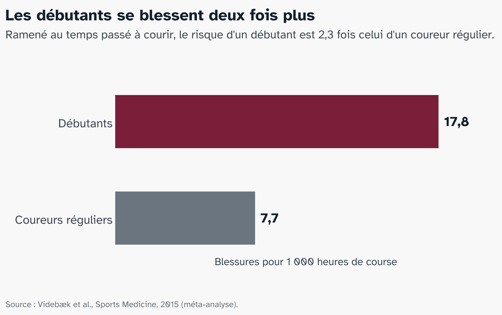

# Le problème {.partie background-color="#7A1E3A"}

## Courir : le sport santé de millions de personnes

:::: {.columns}
::: {.column width="50%"}
[13,2 M]{.chiffre}
[de Français ont couru en 2025]{.chiffre-legende}
:::
::: {.column width="50%"}
[1 sur 2]{.chiffre .jaune}
[partants du Marathon de Paris 2026 courait son premier marathon]{.chiffre-legende}
:::
::::

::: {.encadre}
On court d'abord pour sa santé : bien-être (55 %) et santé (50 %) avant la compétition.
:::

::: {.audrey}
[A]{.avatar} Audrey, 39 ans, vient de s'inscrire à son premier marathon.
:::

::: {.source}
Observatoire du running, Union Sport & Cycle, 2026 · Chiffres officiels du Marathon de Paris 2026
:::

::: notes
**À dire.** Levez la main si vous avez couru cette année. 40 % des Français courent au moins de temps en temps : une paire de chaussures suffit, et c'est l'un des moyens les plus simples d'atteindre les 150 minutes d'activité par semaine recommandées par l'OMS. Beaucoup s'y mettent à l'approche d'une nouvelle décennie, souvent avec un marathon en tête : c'est le cas d'Audrey.

**Si on vous demande.** Audrey est un personnage fictif, construit à partir des chiffres de ces slides. 40 % : Odoxa, 2023. Marathon : âge moyen 38 ans ; les gens de 29, 39 ou 49 ans sont 48 % plus nombreux que prévu parmi les premiers marathoniens (Alter et Hershfield, PNAS, 2014).
:::

## Mais ceux qui débutent se blessent deux fois plus {.figure-seule}

::: {.figure-pleine}

:::

::: notes
**À dire.** Selon les études, entre 1 coureur sur 5 et 4 sur 5 se blesse à la jambe dans l'année. Par heure de course, un débutant se blesse 2,3 fois plus qu'un coureur régulier : le souffle progresse plus vite que les tendons, le cartilage et l'os.

**Si on vous demande.** van Gent, 2007. Sur 675 premiers marathoniens à New York, 9,5 % ont eu une blessure grave qui les a empêchés de courir ou de finir.
:::

## Le genou est le premier touché

:::: {.columns}
::: {.column width="42%"}
[28 %]{.chiffre}
[des blessures du coureur touchent le genou, plus d'une sur quatre]{.chiffre-legende}
:::
::: {.column width="58%"}
::: {.pastille .p}
[PFPS · syndrome fémoro-patellaire]{.nom}
[n° 1 · 17 % des blessures du coureur]{.rang}
[**Où :** devant le genou, autour et derrière la rotule.]{.detail}
[**Quoi :** l'articulation entre la rotule et le fémur est surchargée. Aucune lésion visible : ni ligament, ni tendon, ni ménisque.]{.detail}
:::
::: {.pastille .i}
[ITBS · syndrome de la bandelette ilio-tibiale]{.nom}
[n° 2 · touche 2 à 12 % des coureurs]{.rang}
[**Où :** côté externe, juste au-dessus du genou.]{.detail}
[**Quoi :** la bandelette, une bande fibreuse qui descend du bassin au tibia, comprime contre le fémur un coussinet de graisse très innervé.]{.detail}
:::
:::
::::

::: {.audrey}
[A]{.avatar} Trois mois plus tard, Audrey a mal au genou dès qu'elle court.
:::

::: {.source}
Francis et al., J Sports Sci Med, 2019 (36 études, 10 688 blessures) · Taunton et al., Br J Sports Med, 2002 · Crossley et al., Br J Sports Med, 2016 · Fairclough et al., J Anat, 2006 · revue ITBS, Curr Phys Med Rehabil Rep, 2024
:::

::: notes
**À dire.** Le genou est l'articulation la plus touchée : 28 % des blessures du coureur. Les deux diagnostics les plus fréquents sont le syndrome fémoro-patellaire, une douleur autour de la rotule, et le syndrome de la bandelette ilio-tibiale, une douleur sur le côté externe du genou. Ce ne sont pas des gênes passagères : jusqu'à 57 % des adultes avec un PFPS ont encore une évolution défavorable 5 à 8 ans après.

**Si on vous demande.** 28 % porte sur l'ensemble des coureurs (36 études, 10 688 blessures) ; les 40 % chez les femmes (31 % chez les hommes) viennent de 8 études seulement, d'où leur absence de la slide. 17 % des blessures pour le PFPS (Francis) ; 1,6 à 12 % des coureurs touchés pour l'ITBS (revue 2024) ; classement n° 1 et n° 2 : Taunton, 2002 ; évolution défavorable : IASP, 2023. PFPS : la rotule glisse dans la gorge du fémur (trochlée) ; douleur quand le genou plié porte le poids du corps ; pas de lésion visible à l'imagerie. ITBS : la bandelette est un épaississement du fascia lata, tendu par le tenseur du fascia lata et le grand fessier ; elle va de la crête iliaque au tibia (tubercule de Gerdy). Elle ne frotte pas : attachée au fémur, elle comprime un tissu graisseux très innervé vers 20 à 30° de flexion (Fairclough et al., J Anat, 2006). Vérifié dans nos données : genou le plus touché, PFPS et ITBS diagnostics précis les plus fréquents.
:::

## Deux douleurs au genou, une origine à la hanche

:::: {.columns}
::: {.column width="46%"}
```{=html}
<svg viewBox="0 0 640 620" width="100%" role="img" aria-label="Coureuse vue de face : d'un côté la jambe alignée, de l'autre la cuisse qui rentre et le genou qui part vers l'intérieur">
  <defs>
    <marker id="fl" viewBox="0 0 10 10" refX="8" refY="5" markerWidth="7" markerHeight="7" orient="auto-start-reverse">
      <path d="M0 0L10 5L0 10z" fill="#14202E"/>
    </marker>
  </defs>
  <!-- axe du corps, au centre -->
  <line x1="320" y1="62" x2="320" y2="575" stroke="#B9BEC5" stroke-width="2" stroke-dasharray="8 8"/>
  <text x="320" y="44" font-size="19" fill="#6B7580" text-anchor="middle">axe du corps</text>
  <!-- bassin, symétrique -->
  <path d="M165 118 Q320 84 475 118 L458 190 Q320 168 182 190 Z" fill="#E3E5E8" stroke="#5E6A77" stroke-width="3"/>
  <text x="320" y="146" font-size="21" fill="#3F4A57" text-anchor="middle">bassin</text>
  <!-- jambe de droite (écran) : alignée -->
  <line x1="420" y1="196" x2="420" y2="375" stroke="#9AA3AD" stroke-width="26" stroke-linecap="round"/>
  <line x1="420" y1="375" x2="420" y2="562" stroke="#9AA3AD" stroke-width="20" stroke-linecap="round"/>
  <!-- jambe de gauche (écran) : alignée au départ, puis fantôme -->
  <g class="fragment fade-out" data-fragment-index="1">
    <line x1="220" y1="196" x2="220" y2="375" stroke="#9AA3AD" stroke-width="26" stroke-linecap="round"/>
    <line x1="220" y1="375" x2="220" y2="562" stroke="#9AA3AD" stroke-width="20" stroke-linecap="round"/>
  </g>
  <g class="fragment" data-fragment-index="1">
    <line x1="220" y1="196" x2="220" y2="375" stroke="#D5D9DE" stroke-width="26" stroke-linecap="round"/>
    <line x1="220" y1="375" x2="220" y2="562" stroke="#D5D9DE" stroke-width="20" stroke-linecap="round"/>
    <line x1="220" y1="196" x2="272" y2="372" stroke="#5E6A77" stroke-width="26" stroke-linecap="round"/>
    <line x1="272" y1="372" x2="230" y2="562" stroke="#5E6A77" stroke-width="20" stroke-linecap="round"/>
    <path d="M186 292 A100 100 0 0 0 262 290" fill="none" stroke="#14202E" stroke-width="3.5" marker-end="url(#fl)"/>
    <text x="30" y="286" font-size="20" fill="#14202E" font-weight="700">la cuisse</text>
    <text x="30" y="310" font-size="20" fill="#14202E" font-weight="700">rentre</text>
  </g>
  <circle cx="220" cy="196" r="20" fill="#5E6A77"/>
  <circle cx="420" cy="196" r="20" fill="#5E6A77"/>
  <!-- les deux douleurs -->
  <g class="fragment" data-fragment-index="2">
    <path d="M176 172 C188 255 222 335 252 392" fill="none" stroke="#7A1E3A" stroke-width="7" stroke-linecap="round"/>
    <circle cx="250" cy="343" r="11" fill="#7A1E3A" fill-opacity="0.35" stroke="#7A1E3A" stroke-width="3"/>
    <text x="30" y="440" font-size="24" font-weight="700" fill="#7A1E3A">ITBS</text>
    <text x="30" y="466" font-size="19" fill="#3F4A57">bandelette,</text>
    <text x="30" y="490" font-size="19" fill="#3F4A57">côté externe</text>
    <line x1="92" y1="432" x2="240" y2="352" stroke="#7A1E3A" stroke-width="2"/>
    <circle cx="279" cy="364" r="21" fill="#C98A1A" fill-opacity="0.2"/>
    <ellipse cx="279" cy="366" rx="12" ry="16" fill="#fff" stroke="#C98A1A" stroke-width="4"/>
    <text x="334" y="268" font-size="24" font-weight="700" fill="#C98A1A">PFPS</text>
    <text x="334" y="292" font-size="19" fill="#3F4A57">derrière</text>
    <text x="334" y="314" font-size="19" fill="#3F4A57">la rotule</text>
    <line x1="330" y1="310" x2="292" y2="352" stroke="#C98A1A" stroke-width="2"/>
  </g>
  <text x="320" y="608" font-size="18" fill="#6B7580" text-anchor="middle">Coureuse vue de face. Gris clair : position alignée.</text>
</svg>
```
:::
::: {.column width="54%"}
Filmées **avant** de se blesser, les coureuses qui ont eu ensuite un [PFPS]{.pfps} ou un [ITBS]{.itbs} avaient plus d'**adduction de hanche** : la cuisse rentre vers l'intérieur.

::: {.encadre .fragment fragment-index=3}
Pour comprendre la blessure, il faut regarder la foulée.
:::
:::
::::

::: {.source}
Noehren et al., Clin Biomech, 2007 · Noehren et al., Med Sci Sports Exerc, 2013
:::

::: notes
**À dire.** Trois clics. Quand la cuisse rentre vers l'intérieur, c'est l'adduction de hanche : la rotule est déportée et la bandelette se tend, les deux douleurs apparaissent. Chez des coureuses suivies avant leur blessure, celles qui se sont blessées avaient plus d'adduction de hanche ; pour l'ITBS, s'y ajoute une rotation interne du genou. Les deux syndromes se ressemblent dans la foulée, sans être identiques.

**Si on vous demande.** PFPS : 400 coureuses suivies, 15 cas. ITBS : 18 cas, adduction de hanche et rotation interne du genou. Mécanisme ITBS actuel : compression d'un coussinet graisseux très innervé quand le genou dépasse environ 30° de flexion, juste après l'impact.
:::

## Aucun examen ne tranche : la foulée peut-elle aider ?

```{=html}
<svg viewBox="0 0 1390 230" width="100%" role="img" aria-label="Parcours diagnostique : douleur au genou, examen à l'arrêt, on écarte les autres causes, diagnostic incertain">
  <defs>
    <marker id="fd" viewBox="0 0 10 10" refX="8" refY="5" markerWidth="8" markerHeight="8" orient="auto">
      <path d="M0 0L10 5L0 10z" fill="#6B7580"/>
    </marker>
  </defs>
  <g font-size="26" text-anchor="middle">
    <rect x="10" y="40" width="290" height="120" rx="16" fill="#fff" stroke="#E3E5E8" stroke-width="3"/>
    <text x="155" y="92" font-weight="700" fill="#14202E">Douleur</text>
    <text x="155" y="126" fill="#3F4A57">au genou</text>
    <rect x="370" y="40" width="290" height="120" rx="16" fill="#fff" stroke="#E3E5E8" stroke-width="3"/>
    <text x="515" y="92" font-weight="700" fill="#14202E">Examen</text>
    <text x="515" y="126" fill="#3F4A57">à l'arrêt</text>
    <rect x="730" y="40" width="290" height="120" rx="16" fill="#fff" stroke="#E3E5E8" stroke-width="3"/>
    <text x="875" y="92" font-weight="700" fill="#14202E">On écarte</text>
    <text x="875" y="126" fill="#3F4A57">les autres causes</text>
    <rect x="1090" y="40" width="290" height="120" rx="16" fill="#F6E7C8" stroke="#C98A1A" stroke-width="4"/>
    <text x="1235" y="92" font-weight="700" fill="#14202E"><tspan fill="#C98A1A">PFPS</tspan> ? <tspan fill="#7A1E3A">ITBS</tspan> ?</text>
    <text x="1235" y="126" fill="#3F4A57">sans test de référence</text>
  </g>
  <g stroke="#6B7580" stroke-width="3">
    <line x1="305" y1="100" x2="362" y2="100" marker-end="url(#fd)"/>
    <line x1="665" y1="100" x2="722" y2="100" marker-end="url(#fd)"/>
    <line x1="1025" y1="100" x2="1082" y2="100" marker-end="url(#fd)"/>
  </g>
  <line x1="515" y1="160" x2="515" y2="180" stroke="#7A1E3A" stroke-width="2.5"/>
  <text x="515" y="210" font-size="22" fill="#7A1E3A" text-anchor="middle" font-weight="700">or la blessure se joue en courant</text>
</svg>
```

::: {.audrey}
[A]{.avatar} Son kiné hésite : PFPS ? ITBS ? Rien ne permet de trancher.
:::

::: {.question .fragment}
La foulée suffit-elle à reconnaître un coureur atteint d'un PFPS ou d'un ITBS ?
:::

::: {.question .fragment}
Ce que regardent les modèles a-t-il un sens biologique ?
:::

::: {.source}
Crossley et al., consensus PFPS, Br J Sports Med, 2016 · revue ITBS, Curr Phys Med Rehabil Rep, 2024
:::

::: notes
**À dire.** Aucun examen ne tranche : le PFPS se diagnostique quand on n'a rien trouvé d'autre, et les tests de l'ITBS sont jugés peu fiables. D'où notre question : la foulée elle-même peut-elle aider ? Deux outils : le machine learning compare des mesures résumées, le deep learning lit les mouvements bruts.

**Si on vous demande.** ITBS : sensibilité et spécificité des tests jugées « pas satisfaisantes ». Dans notre clinique, le diagnostic le plus fréquent n'est ni l'un ni l'autre mais « douleur » (232 séances sur 1 832).
:::
