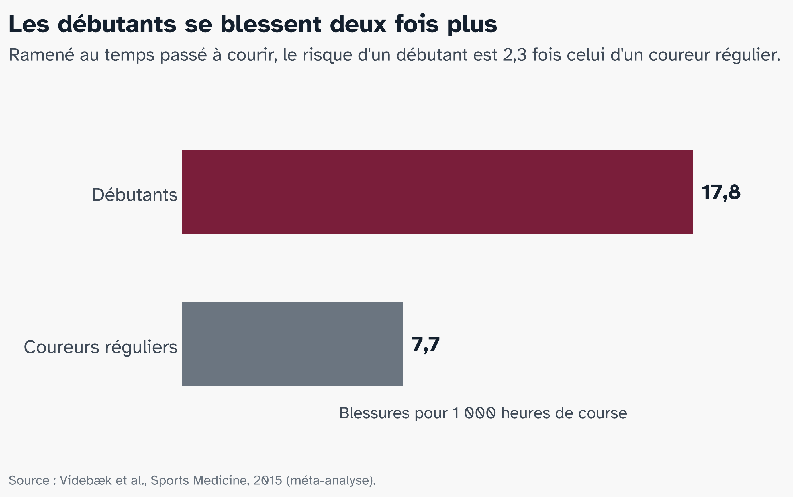

# Le problème {.partie background-color="#7A1E3A"}

## Courir : le sport santé de millions de personnes

:::: {.columns}
::: {.column width="50%"}
[13,2 M]{.chiffre}
[de Français ont couru en 2025]{.chiffre-legende}
:::
::: {.column width="50%"}
[1 sur 2]{.chiffre .jaune}
[partants du Marathon de Paris 2026 courait son premier marathon]{.chiffre-legende}
:::
::::

::: {.encadre}
On court d'abord pour sa santé : bien-être (55 %) et santé (50 %) avant la compétition.
:::

::: {.audrey}
[A]{.avatar} Audrey, 39 ans, vient de s'inscrire à son premier marathon.
:::

::: {.source}
Observatoire du running, Union Sport & Cycle, 2026 · Chiffres officiels du Marathon de Paris 2026
:::

::: notes
Audrey est un personnage fictif, construit à partir des chiffres de ces slides (âge moyen des marathoniens, débutante, crise de la décennie). Le dire si on vous le demande. Accroche : « Levez la main si vous avez couru cette année. » 40 % des Français courent au moins de temps en temps (Odoxa, 2023). Une paire de chaussures suffit : ni club, ni terrain, ni horaire, et c'est l'un des moyens les plus simples d'atteindre les 150 minutes d'activité par semaine recommandées par l'OMS.

Marathon : âge moyen 38 ans. Les gens de 29, 39 ou 49 ans sont 48 % plus nombreux que prévu parmi les premiers marathoniens : approcher une nouvelle décennie pousse à se lancer un défi, la « crise de la trentaine » mesurée dans les données (Alter et Hershfield, PNAS, 2014). Image à faire passer : un adulte qui court depuis peu et s'inscrit à un marathon.
:::

## Mais ceux qui débutent se blessent deux fois plus {.figure-seule}

::: {.figure-pleine}

:::

::: notes
Selon les études, entre 1 coureur sur 5 et 4 sur 5 se blesse à la jambe dans l'année (van Gent, 2007). Par heure de course, un débutant se blesse 2,3 fois plus qu'un coureur régulier. Hypothèse admise : le souffle progresse plus vite que les tendons, le cartilage et l'os ; on se sent capable de courir plus avant que le corps soit prêt. Pour le marathon : sur 675 premiers marathoniens à New York, 9,5 % ont eu une blessure grave qui les a empêchés de courir ou de finir.
:::

## Le genou est le premier touché

:::: {.columns}
::: {.column width="42%"}
[28 %]{.chiffre}
[des blessures du coureur touchent le genou, plus d'une sur quatre]{.chiffre-legende}
:::
::: {.column width="58%"}
::: {.pastille .p}
[PFPS · syndrome fémoro-patellaire]{.nom}
[n° 1 · 17 % des blessures du coureur]{.rang}
[**Où :** devant le genou, autour et derrière la rotule.]{.detail}
[**Quoi :** l'articulation entre la rotule et le fémur est surchargée. Aucune lésion visible : ni ligament, ni tendon, ni ménisque.]{.detail}
:::
::: {.pastille .i}
[ITBS · syndrome de la bandelette ilio-tibiale]{.nom}
[n° 2 · touche 2 à 12 % des coureurs]{.rang}
[**Où :** côté externe, juste au-dessus du genou.]{.detail}
[**Quoi :** la bandelette, une bande fibreuse qui descend du bassin au tibia, comprime contre le fémur un coussinet de graisse très innervé.]{.detail}
:::
:::
::::

::: {.audrey}
[A]{.avatar} Trois mois plus tard, Audrey a mal au genou dès qu'elle court.
:::

::: {.source}
Francis et al., J Sports Sci Med, 2019 (36 études, 10 688 blessures) · Taunton et al., Br J Sports Med, 2002 · Crossley et al., Br J Sports Med, 2016 · Fairclough et al., J Anat, 2006 · revue ITBS, Curr Phys Med Rehabil Rep, 2024
:::

::: notes
Pourquoi 28 % et pas 40 % : 28 % porte sur l'ensemble des coureurs (36 études, 10 688 blessures). Le chiffre de 40 % chez les femmes (31 % chez les hommes) vient d'un sous-ensemble de 8 études seulement : il ne se compare pas directement au 28 %, d'où son absence de la slide. À citer seulement si on parle d'Audrey ou des différences hommes-femmes. Les deux pourcentages des blessures n'ont pas le même dénominateur : 17 % des blessures pour le PFPS (Francis), 1,6 à 12 % des coureurs touchés pour l'ITBS (revue 2024). Classement n° 1 et n° 2 : Taunton, 2002. Anatomie, pour les questions. PFPS : douleur autour ou derrière la rotule, réveillée quand le genou plié porte le poids du corps (course, escaliers, accroupi) ; c'est l'articulation fémoro-patellaire, où la rotule glisse dans la gorge du fémur (la trochlée). Pas de lésion de structure à l'imagerie ; les tissus en cause sont discutés (os sous le cartilage, coussinet graisseux sous la rotule, capsule). ITBS : la bandelette ilio-tibiale est un épaississement du fascia lata, l'enveloppe fibreuse de la cuisse ; ce n'est ni un muscle ni un tendon au sens strict, mais deux muscles de la hanche tirent dessus (tenseur du fascia lata et grand fessier). Elle part de la crête iliaque et s'attache sur le tibia (tubercule de Gerdy). La douleur siège au-dessus de l'épicondyle latéral du fémur. On parlait de friction (la bande qui frotte en glissant d'avant en arrière) ; l'anatomie montre qu'elle est attachée au fémur et ne glisse pas : elle comprime un tissu graisseux très innervé, surtout vers 20 à 30° de flexion, juste après l'impact (Fairclough et al., J Anat, 2006). Lien avec la hanche : plus la cuisse rentre, plus la bandelette est tendue, et plus la rotule est déportée. Ce ne sont pas des gênes passagères : jusqu'à 57 % des adultes avec un PFPS ont encore une évolution défavorable 5 à 8 ans après (IASP, 2023). Vérifié dans nos données : le genou est l'articulation la plus souvent blessée, et PFPS et ITBS sont les deux diagnostics précis les plus fréquents de la clinique.
:::

## Deux douleurs au genou, une origine à la hanche

:::: {.columns}
::: {.column width="46%"}
```{=html}
<svg viewBox="0 0 640 620" width="100%" role="img" aria-label="Coureuse vue de face : d'un côté la jambe alignée, de l'autre la cuisse qui rentre et le genou qui part vers l'intérieur">
  <defs>
    <marker id="fl" viewBox="0 0 10 10" refX="8" refY="5" markerWidth="7" markerHeight="7" orient="auto-start-reverse">
      <path d="M0 0L10 5L0 10z" fill="#14202E"/>
    </marker>
  </defs>
  <!-- axe du corps, au centre -->
  <line x1="320" y1="62" x2="320" y2="575" stroke="#B9BEC5" stroke-width="2" stroke-dasharray="8 8"/>
  <text x="320" y="44" font-size="19" fill="#6B7580" text-anchor="middle">axe du corps</text>
  <!-- bassin, symétrique -->
  <path d="M165 118 Q320 84 475 118 L458 190 Q320 168 182 190 Z" fill="#E3E5E8" stroke="#5E6A77" stroke-width="3"/>
  <text x="320" y="146" font-size="21" fill="#3F4A57" text-anchor="middle">bassin</text>
  <!-- jambe de droite (écran) : alignée -->
  <line x1="420" y1="196" x2="420" y2="375" stroke="#9AA3AD" stroke-width="26" stroke-linecap="round"/>
  <line x1="420" y1="375" x2="420" y2="562" stroke="#9AA3AD" stroke-width="20" stroke-linecap="round"/>
  <!-- jambe de gauche (écran) : alignée au départ, puis fantôme -->
  <g class="fragment fade-out" data-fragment-index="1">
    <line x1="220" y1="196" x2="220" y2="375" stroke="#9AA3AD" stroke-width="26" stroke-linecap="round"/>
    <line x1="220" y1="375" x2="220" y2="562" stroke="#9AA3AD" stroke-width="20" stroke-linecap="round"/>
  </g>
  <g class="fragment" data-fragment-index="1">
    <line x1="220" y1="196" x2="220" y2="375" stroke="#D5D9DE" stroke-width="26" stroke-linecap="round"/>
    <line x1="220" y1="375" x2="220" y2="562" stroke="#D5D9DE" stroke-width="20" stroke-linecap="round"/>
    <line x1="220" y1="196" x2="272" y2="372" stroke="#5E6A77" stroke-width="26" stroke-linecap="round"/>
    <line x1="272" y1="372" x2="230" y2="562" stroke="#5E6A77" stroke-width="20" stroke-linecap="round"/>
    <path d="M186 292 A100 100 0 0 0 262 290" fill="none" stroke="#14202E" stroke-width="3.5" marker-end="url(#fl)"/>
    <text x="30" y="286" font-size="20" fill="#14202E" font-weight="700">la cuisse</text>
    <text x="30" y="310" font-size="20" fill="#14202E" font-weight="700">rentre</text>
  </g>
  <circle cx="220" cy="196" r="20" fill="#5E6A77"/>
  <circle cx="420" cy="196" r="20" fill="#5E6A77"/>
  <!-- les deux douleurs -->
  <g class="fragment" data-fragment-index="2">
    <path d="M176 172 C188 255 222 335 252 392" fill="none" stroke="#7A1E3A" stroke-width="7" stroke-linecap="round"/>
    <circle cx="250" cy="343" r="11" fill="#7A1E3A" fill-opacity="0.35" stroke="#7A1E3A" stroke-width="3"/>
    <text x="30" y="440" font-size="24" font-weight="700" fill="#7A1E3A">ITBS</text>
    <text x="30" y="466" font-size="19" fill="#3F4A57">bandelette,</text>
    <text x="30" y="490" font-size="19" fill="#3F4A57">côté externe</text>
    <line x1="92" y1="432" x2="240" y2="352" stroke="#7A1E3A" stroke-width="2"/>
    <circle cx="279" cy="364" r="21" fill="#C98A1A" fill-opacity="0.2"/>
    <ellipse cx="279" cy="366" rx="12" ry="16" fill="#fff" stroke="#C98A1A" stroke-width="4"/>
    <text x="334" y="268" font-size="24" font-weight="700" fill="#C98A1A">PFPS</text>
    <text x="334" y="292" font-size="19" fill="#3F4A57">derrière</text>
    <text x="334" y="314" font-size="19" fill="#3F4A57">la rotule</text>
    <line x1="330" y1="310" x2="292" y2="352" stroke="#C98A1A" stroke-width="2"/>
  </g>
  <text x="320" y="608" font-size="18" fill="#6B7580" text-anchor="middle">Coureuse vue de face. Gris clair : position alignée.</text>
</svg>
```
:::
::: {.column width="54%"}
Filmées **avant** de se blesser, les coureuses qui ont eu ensuite un [PFPS]{.pfps} ou un [ITBS]{.itbs} avaient plus d'**adduction de hanche** : la cuisse rentre vers l'intérieur.

::: {.encadre .fragment fragment-index=3}
Pour comprendre la blessure, il faut regarder la foulée.
:::
:::
::::

::: {.source}
Noehren et al., Clin Biomech, 2007 · Noehren et al., Med Sci Sports Exerc, 2013
:::

::: notes
Trois clics. Au départ, les deux jambes sont alignées de part et d'autre de l'axe du corps. Clic 1 : d'un côté la cuisse rentre (adduction de hanche) ; les deux douleurs apparaissent ; la phrase à retenir. PFPS : 400 coureuses suivies, 15 cas, plus d'adduction de hanche avant la blessure. ITBS : 18 cas, plus d'adduction de hanche et de rotation interne du genou. Les deux partagent un signe, l'ITBS y ajoute une rotation : elles se ressemblent dans la foulée sans être identiques. Mécanisme ITBS actuel : compression d'un coussinet graisseux très innervé quand le genou dépasse environ 30° de flexion, juste après l'impact.
:::

## Aucun examen ne tranche : la foulée peut-elle aider ?

```{=html}
<svg viewBox="0 0 1390 230" width="100%" role="img" aria-label="Parcours diagnostique : douleur au genou, examen à l'arrêt, on écarte les autres causes, diagnostic incertain">
  <defs>
    <marker id="fd" viewBox="0 0 10 10" refX="8" refY="5" markerWidth="8" markerHeight="8" orient="auto">
      <path d="M0 0L10 5L0 10z" fill="#6B7580"/>
    </marker>
  </defs>
  <g font-size="26" text-anchor="middle">
    <rect x="10" y="40" width="290" height="120" rx="16" fill="#fff" stroke="#E3E5E8" stroke-width="3"/>
    <text x="155" y="92" font-weight="700" fill="#14202E">Douleur</text>
    <text x="155" y="126" fill="#3F4A57">au genou</text>
    <rect x="370" y="40" width="290" height="120" rx="16" fill="#fff" stroke="#E3E5E8" stroke-width="3"/>
    <text x="515" y="92" font-weight="700" fill="#14202E">Examen</text>
    <text x="515" y="126" fill="#3F4A57">à l'arrêt</text>
    <rect x="730" y="40" width="290" height="120" rx="16" fill="#fff" stroke="#E3E5E8" stroke-width="3"/>
    <text x="875" y="92" font-weight="700" fill="#14202E">On écarte</text>
    <text x="875" y="126" fill="#3F4A57">les autres causes</text>
    <rect x="1090" y="40" width="290" height="120" rx="16" fill="#F6E7C8" stroke="#C98A1A" stroke-width="4"/>
    <text x="1235" y="92" font-weight="700" fill="#14202E"><tspan fill="#C98A1A">PFPS</tspan> ? <tspan fill="#7A1E3A">ITBS</tspan> ?</text>
    <text x="1235" y="126" fill="#3F4A57">sans test de référence</text>
  </g>
  <g stroke="#6B7580" stroke-width="3">
    <line x1="305" y1="100" x2="362" y2="100" marker-end="url(#fd)"/>
    <line x1="665" y1="100" x2="722" y2="100" marker-end="url(#fd)"/>
    <line x1="1025" y1="100" x2="1082" y2="100" marker-end="url(#fd)"/>
  </g>
  <line x1="515" y1="160" x2="515" y2="180" stroke="#7A1E3A" stroke-width="2.5"/>
  <text x="515" y="210" font-size="22" fill="#7A1E3A" text-anchor="middle" font-weight="700">or la blessure se joue en courant</text>
</svg>
```

::: {.audrey}
[A]{.avatar} Son kiné hésite : PFPS ? ITBS ? Rien ne permet de trancher.
:::

::: {.question .fragment}
La foulée suffit-elle à reconnaître un coureur atteint d'un PFPS ou d'un ITBS ?
:::

::: {.question .fragment}
Ce que regardent les modèles a-t-il un sens biologique ?
:::

::: {.source}
Crossley et al., consensus PFPS, Br J Sports Med, 2016 · revue ITBS, Curr Phys Med Rehabil Rep, 2024
:::

::: notes
PFPS : pas de test clinique définitif, pas besoin d'imagerie ; on le retient quand on n'a rien trouvé d'autre. ITBS : sensibilité et spécificité des tests jugées « pas satisfaisantes ». Dans notre clinique, le diagnostic le plus fréquent n'est ni l'un ni l'autre mais « douleur » (232 séances sur 1 832). D'où l'idée : lire la foulée elle-même. Deux outils : le machine learning compare des mesures résumées, le deep learning lit la courbe entière.
:::
