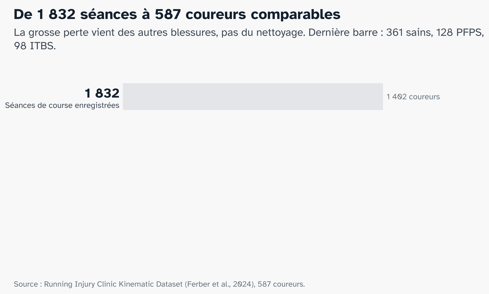
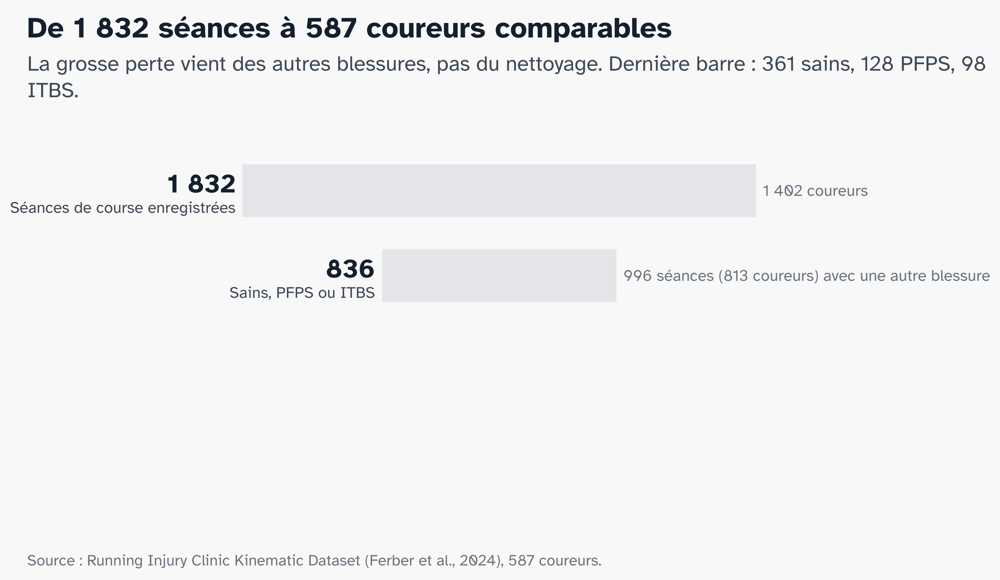
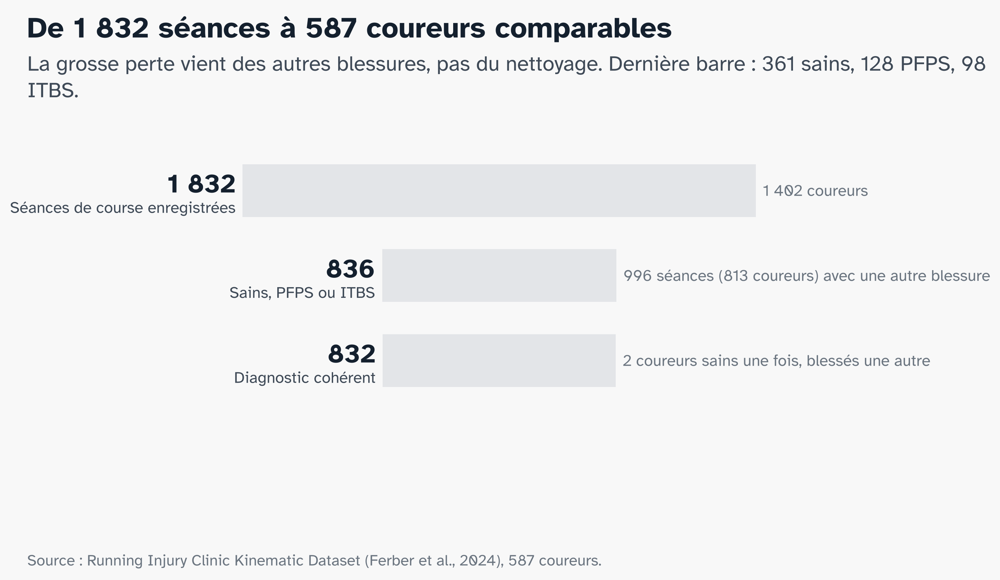
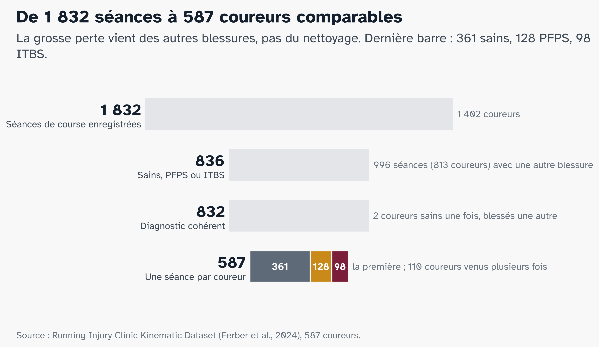
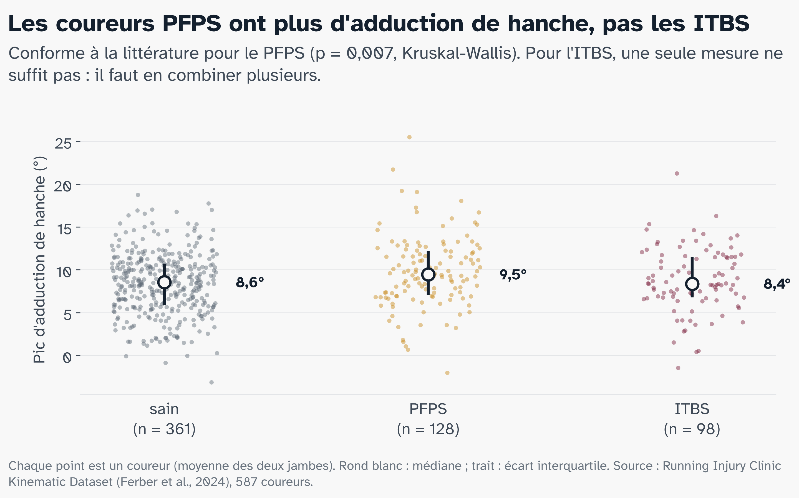
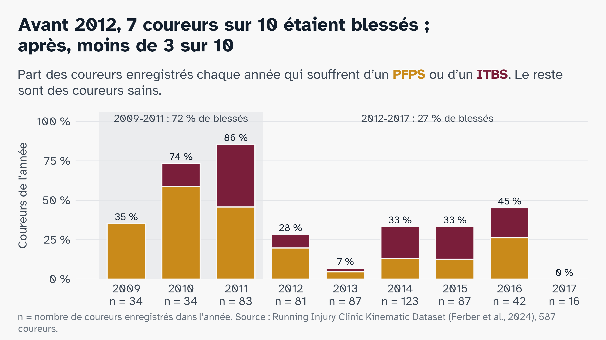

# Les données {.partie background-color="#7A1E3A"}

## Une clinique a filmé près de 1 800 personnes

:::: {.columns}
::: {.column width="58%"}
```{=html}
<svg viewBox="0 0 760 560" width="100%" role="img" aria-label="Coureur sur tapis filmé par des caméras infrarouges, marqueurs sur sept segments">
  <g fill="#14202E">
    <rect x="60" y="40" width="64" height="40" rx="6"/><circle cx="130" cy="60" r="12"/>
    <rect x="646" y="40" width="64" height="40" rx="6"/><circle cx="640" cy="60" r="12"/>
  </g>
  <g stroke="#B9BEC5" stroke-width="2" stroke-dasharray="6 8">
    <line x1="140" y1="68" x2="368" y2="245"/><line x1="630" y1="68" x2="402" y2="245"/>
  </g>
  <text x="385" y="66" font-size="20" fill="#3F4A57" text-anchor="middle">caméras infrarouges</text>
  <rect x="150" y="470" width="470" height="26" rx="13" fill="#5E6A77"/>
  <circle cx="170" cy="483" r="9" fill="#E3E5E8"/><circle cx="600" cy="483" r="9" fill="#E3E5E8"/>
  <text x="385" y="530" font-size="20" fill="#3F4A57" text-anchor="middle">tapis de course, vitesse choisie par le coureur</text>
  <line x1="385" y1="250" x2="400" y2="140" stroke="#B9BEC5" stroke-width="22" stroke-linecap="round"/>
  <circle cx="405" cy="105" r="26" fill="#B9BEC5"/>
  <line x1="398" y1="160" x2="440" y2="215" stroke="#B9BEC5" stroke-width="12" stroke-linecap="round"/>
  <line x1="440" y1="215" x2="470" y2="180" stroke="#B9BEC5" stroke-width="12" stroke-linecap="round"/>
  <line x1="395" y1="165" x2="360" y2="220" stroke="#B9BEC5" stroke-width="12" stroke-linecap="round"/>
  <line x1="385" y1="255" x2="330" y2="345" stroke="#9AA3AD" stroke-width="20" stroke-linecap="round"/>
  <line x1="330" y1="345" x2="262" y2="385" stroke="#9AA3AD" stroke-width="16" stroke-linecap="round"/>
  <line x1="262" y1="385" x2="280" y2="412" stroke="#9AA3AD" stroke-width="12" stroke-linecap="round"/>
  <line x1="385" y1="255" x2="420" y2="360" stroke="#5E6A77" stroke-width="22" stroke-linecap="round"/>
  <line x1="420" y1="360" x2="398" y2="455" stroke="#5E6A77" stroke-width="18" stroke-linecap="round"/>
  <line x1="390" y1="458" x2="448" y2="466" stroke="#5E6A77" stroke-width="13" stroke-linecap="round"/>
  <rect x="362" y="238" width="46" height="30" rx="12" fill="#14202E"/>
  <g stroke="#14202E" stroke-width="2.5" fill="#fff">
    <rect x="392" y="292" width="26" height="26" rx="5"/>
    <rect x="398" y="397" width="24" height="24" rx="5"/>
    <rect x="376" y="447" width="18" height="18" rx="4"/>
    <rect x="344" y="290" width="22" height="22" rx="5"/>
    <rect x="285" y="355" width="20" height="20" rx="4"/>
  </g>
  <g fill="#7A1E3A">
    <circle cx="398" cy="298" r="3.5"/><circle cx="412" cy="298" r="3.5"/><circle cx="405" cy="311" r="3.5"/>
    <circle cx="404" cy="403" r="3.5"/><circle cx="416" cy="403" r="3.5"/><circle cx="410" cy="415" r="3.5"/>
    <circle cx="381" cy="452" r="3"/><circle cx="389" cy="452" r="3"/><circle cx="385" cy="460" r="3"/>
    <circle cx="350" cy="296" r="3"/><circle cx="360" cy="296" r="3"/><circle cx="355" cy="306" r="3"/>
    <circle cx="290" cy="360" r="3"/><circle cx="300" cy="360" r="3"/><circle cx="295" cy="370" r="3"/>
    <circle cx="372" cy="246" r="3.5"/><circle cx="385" cy="246" r="3.5"/><circle cx="398" cy="246" r="3.5"/>
  </g>
  <g font-size="20" fill="#3F4A57">
    <text x="540" y="260">bassin</text><line x1="412" y1="253" x2="530" y2="253" stroke="#3F4A57" stroke-width="1.5"/>
    <text x="540" y="312">cuisse</text><line x1="422" y1="305" x2="530" y2="305" stroke="#3F4A57" stroke-width="1.5"/>
    <text x="540" y="416">jambe</text><line x1="424" y1="409" x2="530" y2="409" stroke="#3F4A57" stroke-width="1.5"/>
    <text x="540" y="463">pied</text><line x1="456" y1="456" x2="530" y2="456" stroke="#3F4A57" stroke-width="1.5"/>
  </g>
  <text x="60" y="360" font-size="20" fill="#7A1E3A" font-weight="700">marqueurs</text>
  <text x="60" y="384" font-size="18" fill="#3F4A57">3-4 par plaque</text>
  <line x1="172" y1="365" x2="282" y2="365" stroke="#7A1E3A" stroke-width="1.5"/>
</svg>
```
:::
::: {.column width="42%"}
- Calgary, **2009 à 2017**
- **1 798** personnes, dont **1 402** ont couru
- **7 segments** suivis, du bassin aux pieds

::: {.encadre}
L'angle de chaque articulation, à chaque instant de la course.
:::

::: {.audrey}
[A]{.avatar} Audrey aurait couru une minute sur ce tapis.
:::
:::
::::

::: {.source}
Ferber et al., Scientific Data, 2024 · Running Injury Clinic Kinematic Dataset, Figshare (CC BY 4.0)
:::

::: notes
Running Injury Clinic, Université de Calgary. Environ 60 secondes de course sur tapis à vitesse libre ; caméras infrarouges Vicon, environ 200 images par seconde ; marqueurs sur le bassin, les deux cuisses, les deux jambes et les deux pieds. Le diagnostic de chaque blessé a été posé par la clinique. Données ouvertes publiées en 2024. Détail pour les questions : le fichier complet fait 22,7 Go ; on n'a lu que les morceaux utiles (environ 6 Go), directement sur le serveur.
:::

## De 1 798 personnes à 587 coureurs {.figure-seule}

::: {.r-stack .figure-pleine}
{.fragment .fade-out fragment-index=1}

{.fragment .fade-in-then-out fragment-index=1}

{.fragment .fade-in-then-out fragment-index=2}

{.fragment fragment-index=3}
:::

::: notes
Une étape par clic, comptée en personnes pour suivre la slide précédente. 1 798 personnes filmées ; 1 402 ont couru (les autres n'ont été filmées qu'en marchant) ; 589 sont saines, PFPS ou ITBS : la grosse perte, 813 coureurs, vient des autres blessures, pas du nettoyage ; 587 après avoir retiré 2 coureurs déclarés sains une fois et blessés une autre. On garde une seule séance par coureur (la première) : sinon le même coureur pourrait se retrouver à la fois dans les données d'entraînement et de test. En séances, pour les questions : 1 832 séances de course, 836 sains/PFPS/ITBS, 832, puis 587. À retenir : 361 sains, 128 PFPS, 98 ITBS.
:::

## 40 mesures par jambe, du bassin au pied

::: {.cartes}
::: {.carte .cle}
[Bassin]{.fam}[3]{.nb}chute du bassin
:::
::: {.carte .cle}
[Hanche]{.fam}[8]{.nb}extension, **adduction**, rotation
:::
::: {.carte .cle}
[Genou]{.fam}[10]{.nb}flexion, varus, valgus, **rotation**
:::
::: {.carte}
[Cheville]{.fam}[10]{.nb}flexion, pronation, rotation
:::
::: {.carte}
[Pied]{.fam}[3]{.nb}attaque au sol, ouverture
:::
::: {.carte}
[Foulée]{.fam}[6]{.nb}cadence, longueur, temps d'appui
:::
:::

::: {.encadre}
En rouge : là où la littérature attend les différences. 79 variables par coureur.
:::

::: notes
Pour chaque articulation : pics, amplitudes et vitesses des angles. Chaque mesure est la médiane sur toutes les foulées enregistrées, calculée par la clinique. Gauche + droite, avec la largeur de pas commune aux deux jambes : 79 variables par coureur. Ce sont les entrées du modèle classique ; le deep learning, lui, lira les courbes complètes des angles pendant l'appui.
:::

## Dans nos données, la hanche se comporte-t-elle comme prévu ? {.figure-seule}

::: {.figure-pleine}

:::

::: notes
Notre propre vérification de l'hypothèse H1, avant tout modèle. Résultat : les PFPS ont plus d'adduction de hanche (médiane 9,5° contre 8,6° chez les sains, p = 0,007), comme chez Noehren ; les ITBS non (8,4°). L'écart des PFPS tient sur 2012-2017 seulement (9,7° contre 8,5°), donc ce n'est pas un effet de l'époque. Message : pour le PFPS, une mesure suffit à voir une tendance ; pour l'ITBS, il faut combiner plusieurs mesures, c'est le rôle des modèles. Attention : la différence de groupe ne permet pas de classer un coureur seul, les nuages de points se chevauchent largement.
:::

## Attention : l'époque se confond avec la blessure {.figure-seule}

::: {.figure-pleine}

:::

::: notes
Avant 2012, 7 coureurs sur 10 sont blessés ; après, moins de 3 sur 10. Or le protocole et la façon de remplir les fiches ont changé entre les deux périodes (vitesse imposée avant 2012, jambe dominante renseignée différemment : voir annexes). Un modèle pourrait donc apprendre l'époque au lieu de la blessure. Ce qu'on fait : l'année n'entre jamais dans les modèles, et on vérifie les résultats sur 2012-2017 seulement. L'article de référence ne fait pas cette vérification. Transition vers Lilou : « À l'œil, ces différences sont trop fines. Un modèle peut-il les voir ? »
:::
