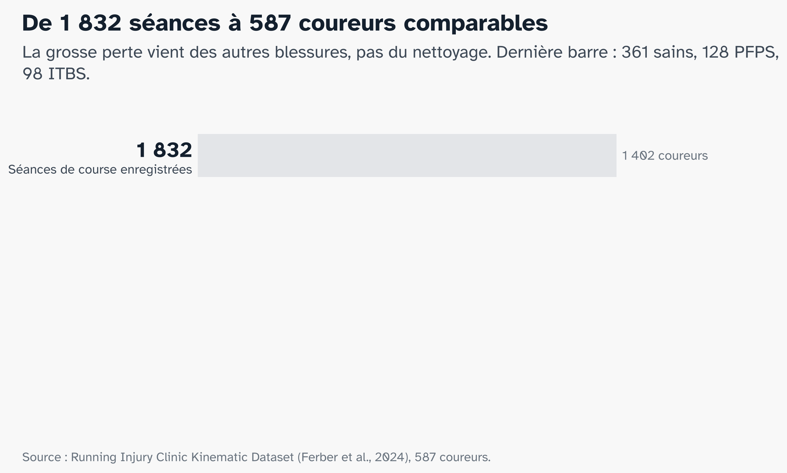
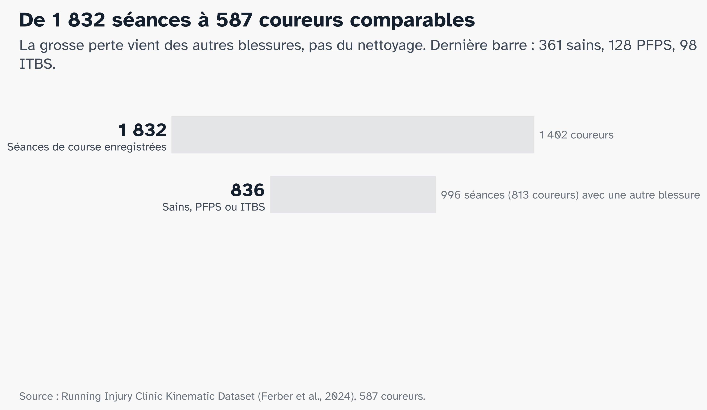
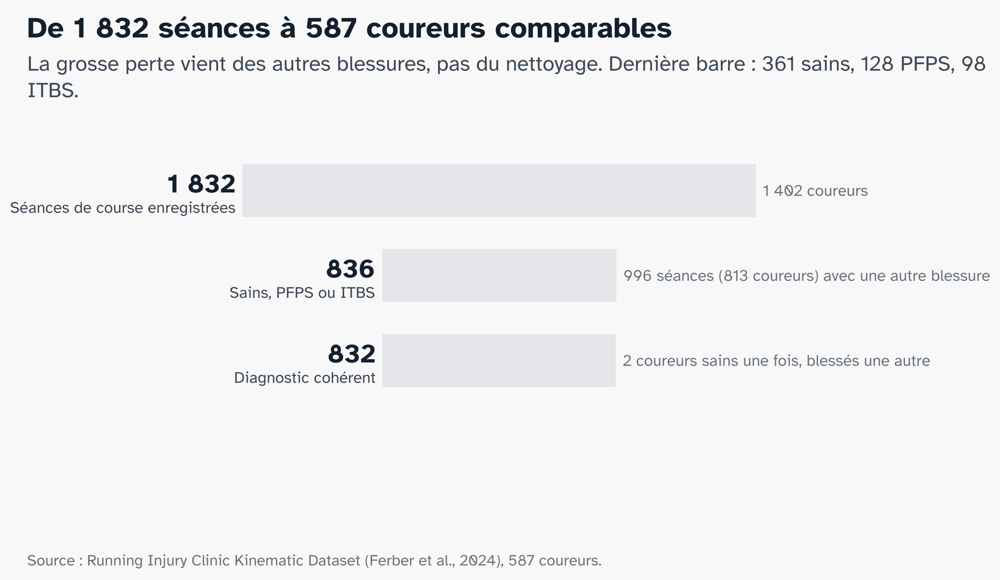
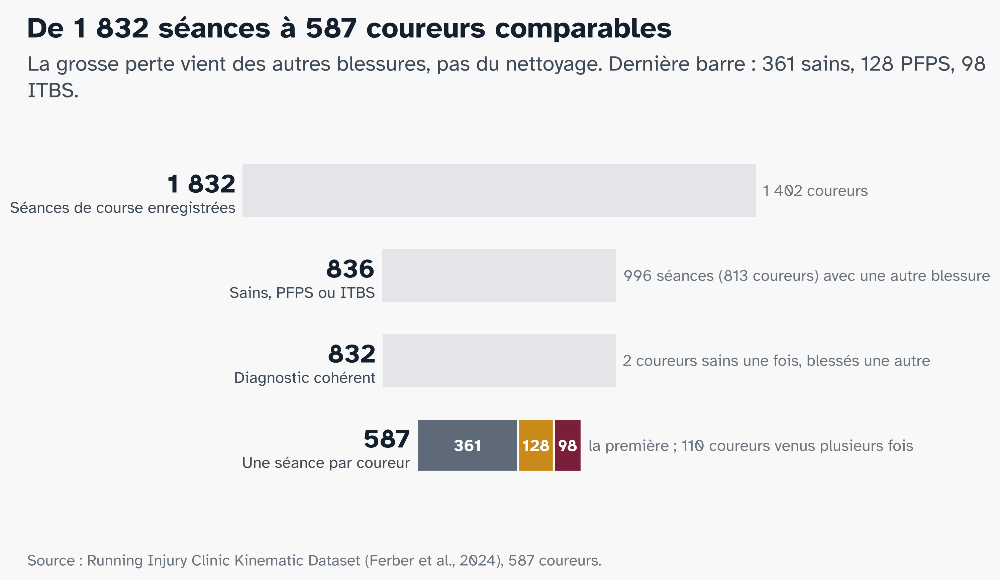
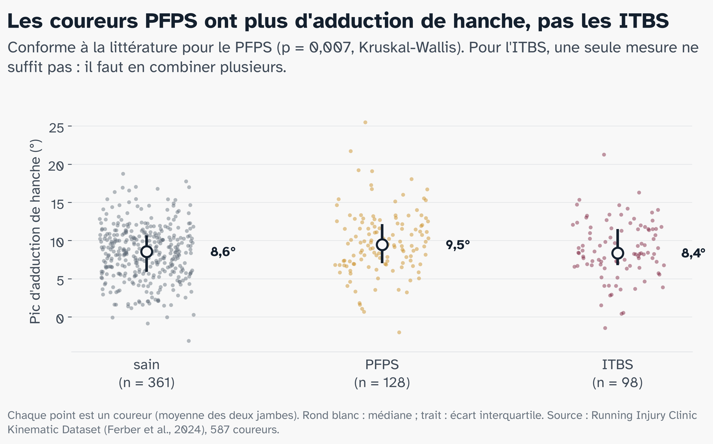
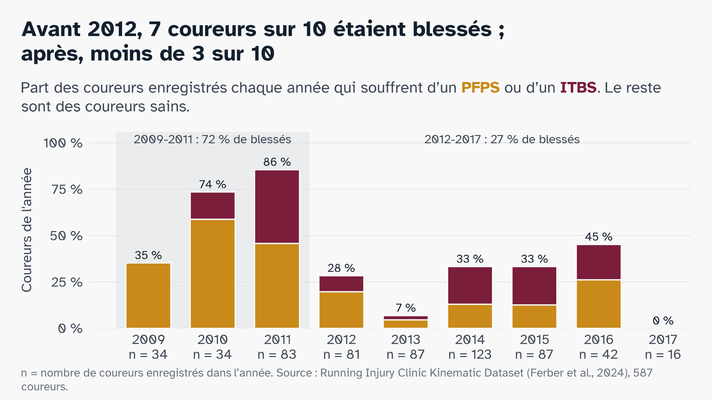

# Les données {.partie background-color="#7A1E3A"}

## Une clinique a filmé près de 1 800 personnes

:::: {.columns}
::: {.column width="58%"}
```{=html}
<svg viewBox="0 0 760 560" width="100%" role="img" aria-label="Coureur sur tapis filmé par des caméras infrarouges, marqueurs sur sept segments">
  <g fill="#14202E">
    <rect x="60" y="40" width="64" height="40" rx="6"/><circle cx="130" cy="60" r="12"/>
    <rect x="646" y="40" width="64" height="40" rx="6"/><circle cx="640" cy="60" r="12"/>
  </g>
  <g stroke="#B9BEC5" stroke-width="2" stroke-dasharray="6 8">
    <line x1="140" y1="68" x2="368" y2="245"/><line x1="630" y1="68" x2="402" y2="245"/>
  </g>
  <text x="385" y="66" font-size="20" fill="#3F4A57" text-anchor="middle">caméras infrarouges</text>
  <rect x="150" y="470" width="470" height="26" rx="13" fill="#5E6A77"/>
  <circle cx="170" cy="483" r="9" fill="#E3E5E8"/><circle cx="600" cy="483" r="9" fill="#E3E5E8"/>
  <text x="385" y="530" font-size="20" fill="#3F4A57" text-anchor="middle">tapis de course, vitesse libre selon le protocole</text>
  <line x1="385" y1="250" x2="400" y2="140" stroke="#B9BEC5" stroke-width="22" stroke-linecap="round"/>
  <circle cx="405" cy="105" r="26" fill="#B9BEC5"/>
  <line x1="398" y1="160" x2="440" y2="215" stroke="#B9BEC5" stroke-width="12" stroke-linecap="round"/>
  <line x1="440" y1="215" x2="470" y2="180" stroke="#B9BEC5" stroke-width="12" stroke-linecap="round"/>
  <line x1="395" y1="165" x2="360" y2="220" stroke="#B9BEC5" stroke-width="12" stroke-linecap="round"/>
  <line x1="385" y1="255" x2="330" y2="345" stroke="#9AA3AD" stroke-width="20" stroke-linecap="round"/>
  <line x1="330" y1="345" x2="262" y2="385" stroke="#9AA3AD" stroke-width="16" stroke-linecap="round"/>
  <line x1="262" y1="385" x2="280" y2="412" stroke="#9AA3AD" stroke-width="12" stroke-linecap="round"/>
  <line x1="385" y1="255" x2="420" y2="360" stroke="#5E6A77" stroke-width="22" stroke-linecap="round"/>
  <line x1="420" y1="360" x2="398" y2="455" stroke="#5E6A77" stroke-width="18" stroke-linecap="round"/>
  <line x1="390" y1="458" x2="448" y2="466" stroke="#5E6A77" stroke-width="13" stroke-linecap="round"/>
  <rect x="362" y="238" width="46" height="30" rx="12" fill="#14202E"/>
  <g stroke="#14202E" stroke-width="2.5" fill="#fff">
    <rect x="392" y="292" width="26" height="26" rx="5"/>
    <rect x="398" y="397" width="24" height="24" rx="5"/>
    <rect x="376" y="447" width="18" height="18" rx="4"/>
    <rect x="344" y="290" width="22" height="22" rx="5"/>
    <rect x="285" y="355" width="20" height="20" rx="4"/>
    <rect x="256" y="391" width="18" height="18" rx="4"/>
  </g>
  <g fill="#7A1E3A">
    <circle cx="398" cy="298" r="3.5"/><circle cx="412" cy="298" r="3.5"/><circle cx="398" cy="311" r="3.5"/><circle cx="412" cy="311" r="3.5"/>
    <circle cx="404" cy="403" r="3.5"/><circle cx="416" cy="403" r="3.5"/><circle cx="404" cy="415" r="3.5"/><circle cx="416" cy="415" r="3.5"/>
    <circle cx="381" cy="452" r="3"/><circle cx="389" cy="452" r="3"/><circle cx="381" cy="460" r="3"/><circle cx="389" cy="460" r="3"/>
    <circle cx="350" cy="296" r="3"/><circle cx="360" cy="296" r="3"/><circle cx="350" cy="306" r="3"/><circle cx="360" cy="306" r="3"/>
    <circle cx="290" cy="360" r="3"/><circle cx="300" cy="360" r="3"/><circle cx="290" cy="370" r="3"/><circle cx="300" cy="370" r="3"/>
    <circle cx="261" cy="396" r="3"/><circle cx="269" cy="396" r="3"/><circle cx="261" cy="404" r="3"/><circle cx="269" cy="404" r="3"/>
  </g>
  <g fill="#F8F8F8">
    <circle cx="372" cy="246" r="3.5"/><circle cx="385" cy="246" r="3.5"/><circle cx="398" cy="246" r="3.5"/><circle cx="385" cy="259" r="3.5"/>
  </g>
  <g font-size="20" fill="#3F4A57">
    <text x="540" y="260">bassin</text><line x1="412" y1="253" x2="530" y2="253" stroke="#3F4A57" stroke-width="1.5"/>
    <text x="540" y="312">cuisse</text><line x1="422" y1="305" x2="530" y2="305" stroke="#3F4A57" stroke-width="1.5"/>
    <text x="540" y="416">jambe</text><line x1="424" y1="409" x2="530" y2="409" stroke="#3F4A57" stroke-width="1.5"/>
    <text x="540" y="463">pied</text><line x1="456" y1="456" x2="530" y2="456" stroke="#3F4A57" stroke-width="1.5"/>
  </g>
  <text x="60" y="360" font-size="20" fill="#7A1E3A" font-weight="700">marqueurs</text>
  <text x="60" y="384" font-size="18" fill="#3F4A57">4 par segment</text>
  <line x1="172" y1="365" x2="282" y2="365" stroke="#7A1E3A" stroke-width="1.5"/>
</svg>
```
:::
::: {.column width="42%"}
- Calgary, **2009 à 2017**
- **1 798** personnes, dont **1 402** ont couru
- **7 segments** suivis, du bassin aux pieds

::: {.encadre}
L'angle de chaque articulation, à chaque instant de la course.
:::

::: {.audrey}
[A]{.avatar} Audrey aurait couru sur ce tapis, filmée une vingtaine de secondes.
:::
:::
::::

::: {.source}
Ferber et al., Scientific Data, 2024 · Running Injury Clinic Kinematic Dataset, Figshare (CC BY 4.0)
:::

::: notes
**À dire.** Ces données viennent de la Running Injury Clinic de Calgary : près de 1 800 personnes filmées entre 2009 et 2017, publiées en accès libre en 2024. Des caméras infrarouges suivent 28 marqueurs, quatre sur chacun des sept segments, 200 fois par seconde, pendant que la personne court sur tapis.

**Si on vous demande.** Le protocole prévoit environ 60 secondes de course à vitesse libre, mais les fichiers gardent de 7 à 60 secondes (25 s en médiane), et avant 2012 la vitesse semble avoir été imposée (annexe). Caméras Vicon. Le diagnostic de chaque blessé a été posé par la clinique. Le fichier complet fait 22,7 Go ; on n'a lu que les morceaux utiles (environ 6 Go), directement sur le serveur.
:::

## De 1 798 personnes à 587 coureurs {.figure-seule}

::: {.r-stack .figure-pleine}
{.fragment .fade-out fragment-index=1}

{.fragment .fade-in-then-out fragment-index=1}

{.fragment .fade-in-then-out fragment-index=2}

{.fragment fragment-index=3}
:::

::: notes
**À dire.** Une étape par clic. Sur 1 798 personnes, 1 402 ont couru. La grosse perte vient des autres blessures : il reste 589 coureurs sains, PFPS ou ITBS, puis 587 après avoir retiré deux coureurs aux diagnostics contradictoires. Au final : 361 sains, 128 PFPS, 98 ITBS.

**Si on vous demande.** Les autres n'ont été filmées qu'en marchant. On garde une seule séance par coureur (la première) : sinon le même coureur pourrait se retrouver à la fois en entraînement et en test. En séances : 1 832 séances de course, 836 sains/PFPS/ITBS, 832, puis 587.
:::

## 40 mesures par jambe, calculées à partir des marqueurs

::: {.cartes}
::: {.carte .cle}
[Bassin]{.fam}[3]{.nb}chute du bassin
:::
::: {.carte .cle}
[Hanche]{.fam}[8]{.nb}extension, **adduction**, rotation
:::
::: {.carte .cle}
[Genou]{.fam}[10]{.nb}flexion, varus, valgus, **rotation**
:::
::: {.carte}
[Cheville]{.fam}[10]{.nb}flexion, pronation, rotation
:::
::: {.carte}
[Pied]{.fam}[3]{.nb}attaque au sol, ouverture
:::
::: {.carte}
[Foulée]{.fam}[6]{.nb}cadence, longueur, temps d'appui
:::
:::

::: {.encadre}
En rouge : là où la littérature attend les différences. 79 variables par coureur.
:::

::: notes
**À dire.** À partir des marqueurs, la clinique calcule les angles de chaque articulation, puis 40 mesures par jambe : des pics, des amplitudes, des vitesses. En rouge, là où la littérature attend les différences. Ce sont les entrées des modèles de Lilou ; Charles, lui, repartira des marqueurs bruts.

**Si on vous demande.** Chaque mesure est la médiane sur toutes les foulées enregistrées. Gauche + droite, avec la largeur de pas commune : 79 variables par coureur.
:::

## Dans nos données, la hanche se comporte-t-elle comme prévu ? {.figure-seule}

::: {.figure-pleine}

:::

::: notes
**À dire.** Avant tout modèle, on a vérifié l'hypothèse dans nos données. Les PFPS ont bien plus d'adduction de hanche que les sains, même en ne gardant que 2012-2017 ; les ITBS, non. Mais les nuages se chevauchent : une mesure seule ne suffit pas à reconnaître un coureur.

**Si on vous demande.** Médiane 9,5° chez les PFPS contre 8,6° chez les sains (p = 0,007), comme chez Noehren ; ITBS 8,4°. Sur 2012-2017 : 9,7° contre 8,5°, donc pas un effet de l'époque. Pour l'ITBS, il faut combiner plusieurs mesures : c'est le rôle des modèles.
:::

## Attention : l'époque se confond avec la blessure {.figure-seule}

::: {.figure-pleine}

:::

::: notes
**À dire.** Attention : avant 2012, 7 coureurs sur 10 sont blessés ; après, moins de 3 sur 10, et le protocole a changé entre les deux. Un modèle pourrait apprendre l'époque au lieu de la blessure. L'année n'entre donc jamais dans les modèles, et on vérifie les résultats sur 2012-2017. Transition vers Lilou : « À l'œil, ces différences sont trop fines. Un modèle peut-il les voir ? »

**Si on vous demande.** Vitesse imposée avant 2012, jambe dominante renseignée différemment : voir annexes. L'article de référence ne fait pas cette vérification.
:::
