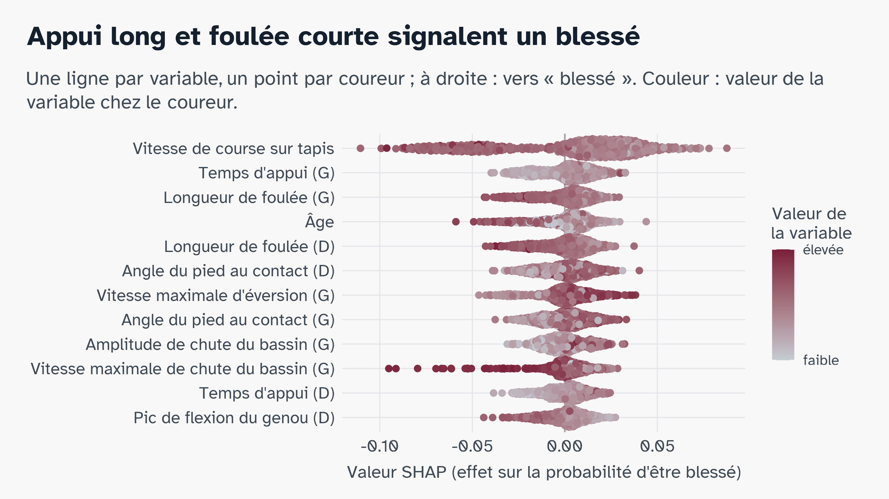

<!-- Annexes de la partie méthodologie. Fichier séparé pour ne pas modifier _06_annexes.qmd :
     il s'affiche une fois ajouté à la liste des fichiers inclus en bas de presentation.qmd. -->

## Les quatre modèles : scores et réglages

::: {.petit}
| Modèle | Blessés reconnus | Sains reconnus | Exactitude équilibrée | AUC |
|---|---|---|---|---|
| Régression logistique | 45 % | 74 % | 0,59 | 0,65 |
| Régression logistique rééquilibrée | **57 %** | 66 % | 0,61 | 0,65 |
| Forêt aléatoire | 27 % | 87 % | 0,57 | 0,67 |
| Forêt aléatoire rééquilibrée | 45 % | 79 % | 0,62 | 0,67 |
:::

[Moyennes sur les 5 plis de test communs (répétition 1, stratifiés sain / PFPS / ITBS). R, tidymodels. Prétraitements appris dans chaque pli d'apprentissage : imputation par la médiane, indicatrices, centrage-réduction ; pour la logistique, retrait des variables corrélées à plus de 0,9. Forêt : ranger, 500 arbres, mtry et min_n par défaut. Rééquilibrage : suréchantillonnage des blessés dans le pli d'apprentissage seulement (themis). Code : modeles/01_modeles_reference.qmd.]{.tres-petit}

## Appui long et foulée courte signalent un blessé {.figure-seule}

::: {.figure-pleine}

:::

::: notes
Graphique en essaim des valeurs SHAP : un point par coureur. À droite, la mesure pousse vers « blessé » ; la couleur donne la valeur de la mesure chez ce coureur. Une vitesse élevée, une foulée longue et un appui court poussent vers « sain ».
:::
