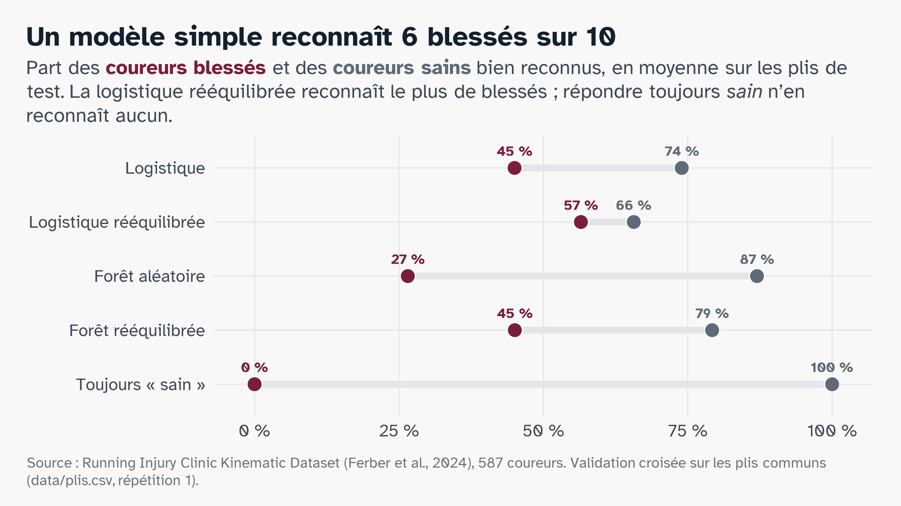
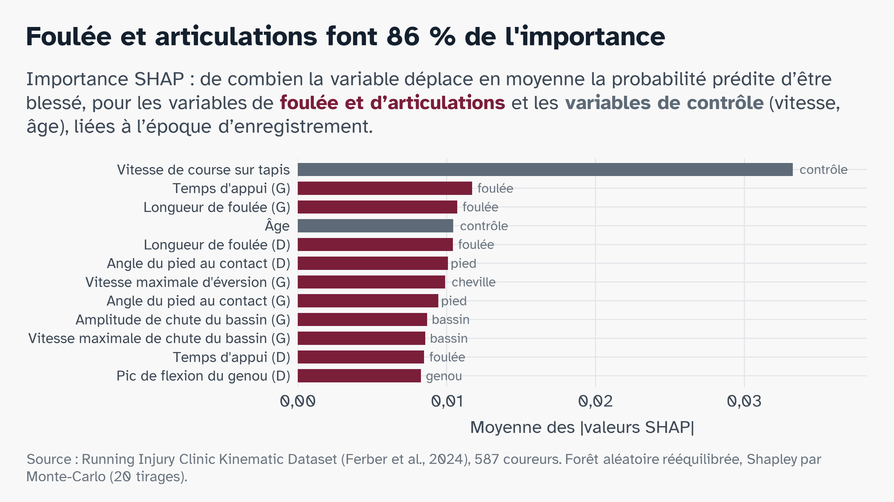

# Méthodologie {.partie background-color="#7A1E3A"}

## Peut-on reconnaître un coureur blessé à ses mesures ?

587 coureurs → 79 mesures de la foulée → modèle → « sain » ou « blessé »

- deux modèles simples : **régression logistique** et **forêt aléatoire**
- chaque modèle est testé sur des coureurs qu'il n'a **jamais vus** (5 plis, répétés 5 fois)
- les mêmes plis servent ensuite au deep learning

::: {.audrey}
[A]{.avatar} Le modèle aurait-il reconnu Audrey parmi les coureurs sains ?
:::

::: notes
Introduire chaque méthode par la question qu'elle sert : « on veut savoir si les mesures suffisent, donc on commence par le modèle le plus simple qui puisse répondre ».
:::

## Le piège : répondre toujours « sain » donne 61 % de bonnes réponses

:::: {.columns}
::: {.column width="45%"}
[61,5 %]{.chiffre}
[de bonnes réponses sans rien regarder : 361 sains sur 587]{.chiffre-legende}
:::
::: {.column width="55%"}
On juge donc chaque modèle sur :

- les **blessés** reconnus (sensibilité)
- les **sains** reconnus (spécificité)
- leur moyenne : 50 % = le hasard
:::
::::

::: notes
La moyenne de la sensibilité et de la spécificité s'appelle l'exactitude équilibrée. C'est le chiffre de référence pour tout le reste de la présentation.
:::

## Un modèle simple reconnaît 6 blessés sur 10 {.figure-seule}

::: {.figure-pleine}

:::

::: notes
La régression logistique rééquilibrée reconnaît 57 % des blessés et 66 % des sains, soit une exactitude équilibrée d'environ 0,60 (0,50 = hasard). Les autres modèles sont du même ordre ; la forêt aléatoire non rééquilibrée penche vers « sain » et ne reconnaît que 27 % des blessés. Le signal est réel mais limité. Scores complets en annexe.
:::

## Après la vitesse, ce sont la foulée, le pied et le bassin qui pèsent {.figure-seule}

::: {.figure-pleine}

:::

::: notes
La vitesse arrive en tête, mais elle est liée à l'époque d'enregistrement (annexe). Viennent ensuite le temps d'appui, la longueur de foulée, l'angle du pied au contact, la vitesse d'éversion et la chute du bassin. La hanche pèse moins que ce qu'annonce la littérature. Sans la vitesse, la logistique garde la même exactitude (0,60) : les angles portent bien une partie du signal.

Transition vers Charles : « Ces mesures résumées suffisent-elles, ou faut-il lire la courbe entière ? »
:::
