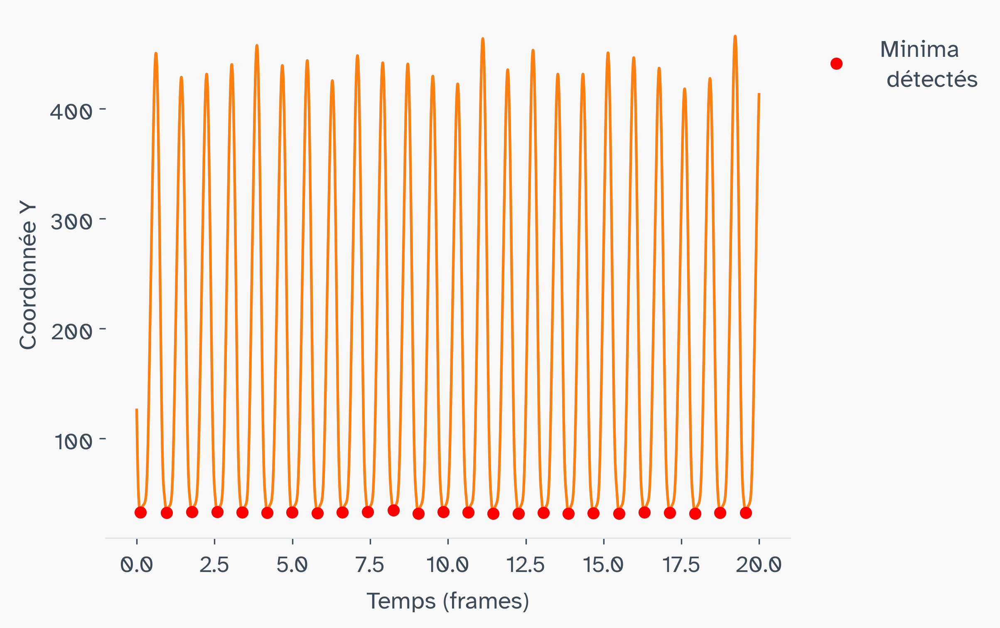
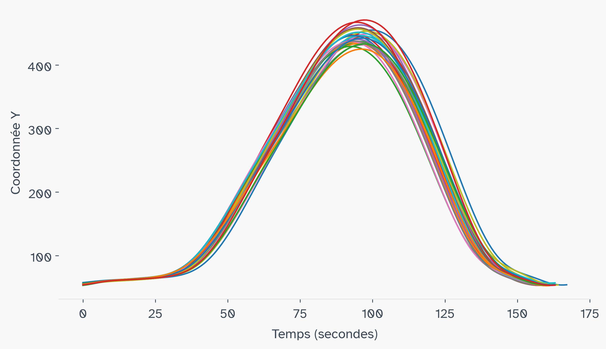
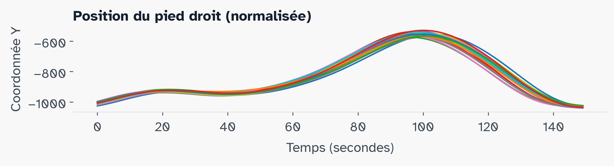
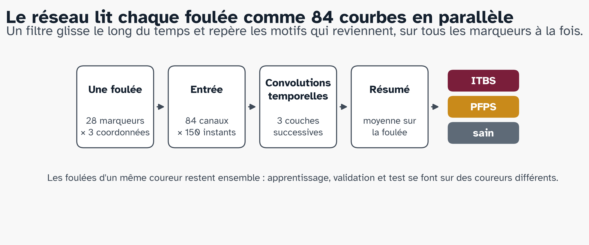
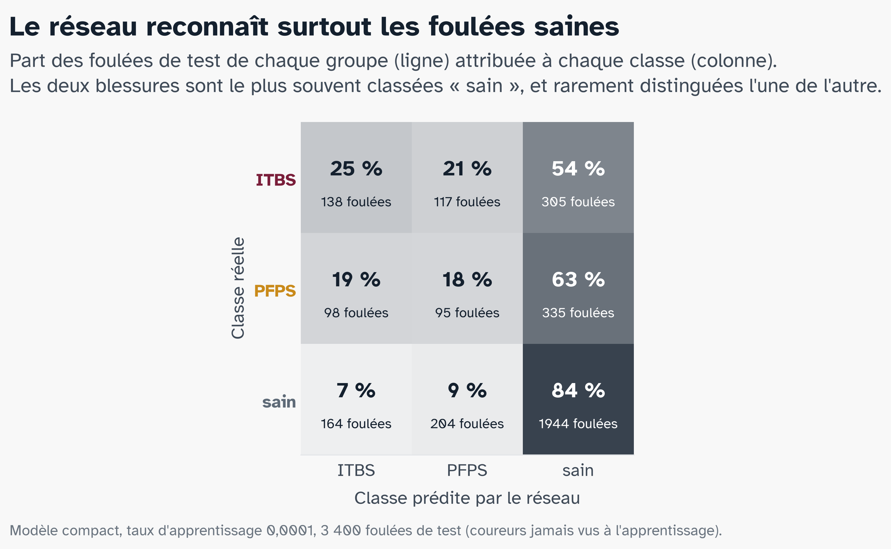

# Illustration {.partie background-color="#7A1E3A"}

## Le réseau part des positions brutes des marqueurs

:::: {.columns}
::: {.column width="45%"}

:::
::: {.column width="55%"}

:::
::::

::: notes
Les 40 mesures par jambe de Lilou sont calculées à partir des marqueurs qu'a montrés Youri : ce sont des résumés, un pic ou une amplitude par articulation. Moi, je suis reparti avant ce résumé : la position en 3D de chaque marqueur, à chaque image de l'enregistrement.

À gauche, les 28 marqueurs que j'utilise : quatre sur le bassin, et quatre sur chaque cuisse, chaque jambe et chaque pied. Chacun donne trois coordonnées (gauche-droite, haut-bas, avant-arrière), soit 84 courbes par coureur.

À droite, le premier problème : les enregistrements n'ont pas tous la même longueur. Ici, 3 346 images pour un coureur et 5 000 pour l'autre, à 200 images par seconde. Sur l'ensemble des coureurs, ça va de 1 333 à 12 000 images. Or un réseau de neurones attend des entrées de taille fixe : je ne peux pas lui donner les séries telles quelles.
:::

## Chaque course est découpée en foulées

:::: {.columns}
::: {.column width="50%"}

:::
::: {.column width="50%"}

:::
::::

lissage → points bas du pied → une foulée entre deux points bas

::: notes
Pour obtenir des morceaux comparables, je découpe chaque course en foulées.

À gauche, la hauteur du pied droit pendant toute la course. Je lisse légèrement le signal pour enlever les petites fluctuations, puis je repère ses minimums : ce sont les moments où le pied est au plus bas, au contact du sol. Pour éviter de détecter deux fois le même appui, j'impose au moins 0,6 seconde entre deux minimums.

Une foulée, c'est tout ce qui se passe entre deux minimums successifs. À droite, toutes les foulées d'un même coureur superposées : elles se ressemblent beaucoup, mais elles n'ont pas exactement la même durée.

Au total, on passe de 587 coureurs à environ 26 000 foulées.
:::

## Les foulées sont mises au même format

:::: {.columns}
::: {.column width="50%"}

:::
::: {.column width="50%"}

:::
::::

1. 150 instants par foulée &nbsp;·&nbsp; 2. positions relatives au bassin &nbsp;·&nbsp; 3. standardisation de chaque canal

::: notes
Trois étapes pour que toutes les foulées soient comparables.

Un : chaque foulée est ramenée à 150 instants par interpolation, pour avoir la même taille d'entrée pour toutes les foulées. C'est la figure de gauche, en haut pour le pied, en bas pour le bassin.

Deux : je recentre toutes les positions sur le centre du bassin, image par image. Sans ça, le réseau verrait surtout où le coureur se tenait sur le tapis, et pas comment il bouge. À droite, le pied droit après recentrage : c'est sa position par rapport au bassin.

Trois : juste avant l'entraînement, je standardise chacun des 84 canaux (moyenne nulle, écart-type un). Les moyennes et les écarts-types sont calculés sur les coureurs d'entraînement uniquement, pour ne rien laisser fuiter du jeu de test.

J'ai aussi écarté les quelques coureurs dont les positions dépassaient 10 mètres, une erreur d'enregistrement.
:::

## Un réseau convolutif lit chaque foulée {.figure-seule}

::: {.figure-pleine}

:::

::: notes
Le modèle est un réseau convolutif à une dimension, l'outil classique pour les séries temporelles.

L'entrée, c'est une foulée : 84 canaux sur 150 instants. Une convolution, c'est un petit filtre qui glisse le long du temps et qui réagit quand il retrouve un motif, par exemple une montée brutale du pied. J'en enchaîne trois couches : les premières repèrent des motifs courts, les suivantes les combinent en motifs plus longs. Le réseau fait ensuite la moyenne de ce qu'il a trouvé sur toute la foulée, et deux petites couches finales choisissent entre ITBS, PFPS et sain.

Point important pour la validité du résultat : toutes les foulées d'un même coureur restent du même côté. 70 % des coureurs servent à l'apprentissage, 15 % à la validation et 15 % au test. Sans ça, le réseau pourrait reconnaître la personne plutôt que la blessure. Les classes sont aussi pondérées, parce qu'il y a beaucoup plus de foulées saines.
:::

## Le réseau apprend par cœur et reconnaît mal les blessures

:::: {.columns}
::: {.column width="48%"}

:::
::: {.column width="52%"}

:::
::::

::: notes
À gauche, l'apprentissage du modèle compact. L'erreur d'apprentissage descend presque à zéro et la précision d'apprentissage atteint 100 % en quelques époques, alors que l'erreur de validation remonte. C'est du surapprentissage : le réseau apprend par cœur les foulées des coureurs qu'il a vus.

À droite, le résultat sur les coureurs de test. 64 % des foulées sont bien classées, mais c'est presque entièrement grâce aux sains : 84 % des foulées saines sont reconnues, contre 25 % des ITBS et 18 % des PFPS. La plupart des foulées de blessés sont classées « sain », et le réseau confond les deux blessures entre elles. Le F1 macro est de 0,43 ; il est de 0,79 pour les sains, mais seulement 0,29 pour l'ITBS et 0,20 pour le PFPS.

Attention à ne pas surinterpréter les 64 % : dans ce jeu de test, 68 % des foulées sont saines, donc répondre toujours « sain » ferait un peu mieux. Le signal existe peut-être, mais ce réseau ne l'isole pas.

Pourquoi ? 26 000 foulées, mais seulement 587 personnes, et les foulées d'un même coureur se ressemblent énormément. Et des positions de marqueurs décrivent la morphologie de la personne autant que son mouvement. En relisant le code, on a aussi vu que l'interpolation coupe la fin des foulées plus longues que 150 images au lieu de les étirer : c'est à corriger. La suite logique serait ensuite de travailler sur des angles articulaires et de donner un seul diagnostic par coureur.
:::
