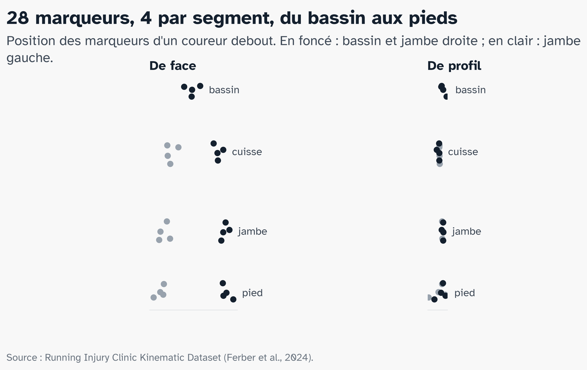
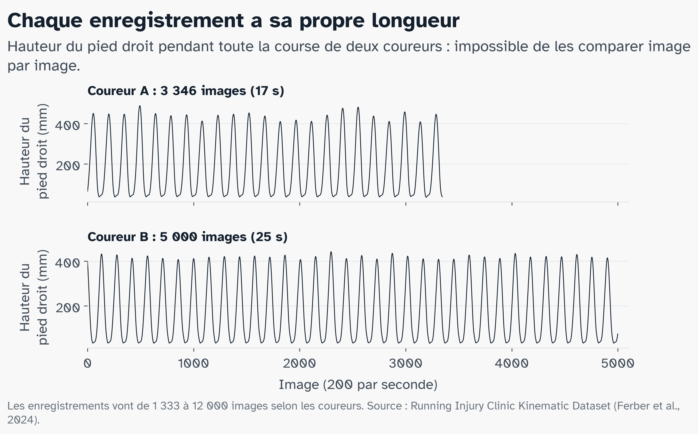
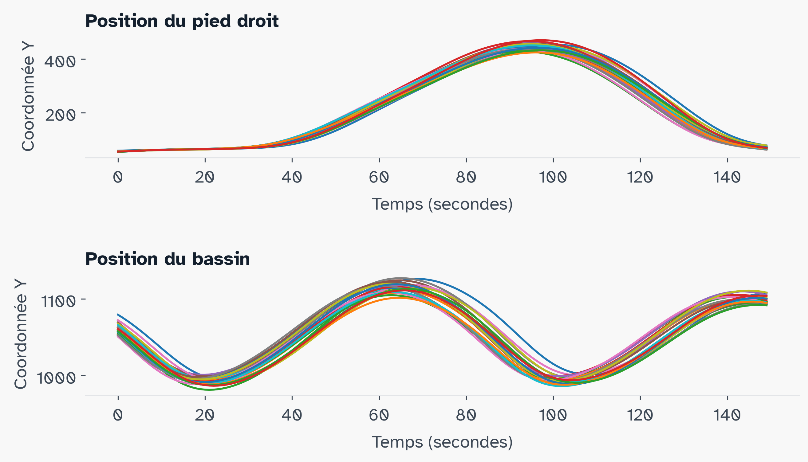
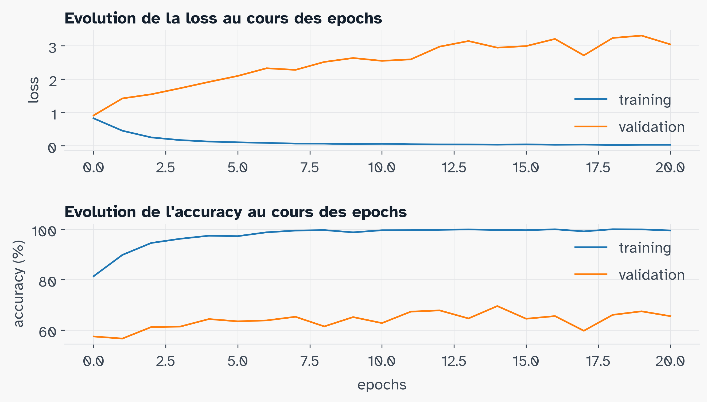

# Illustration {.partie background-color="#7A1E3A"}

## Le réseau part des positions brutes des marqueurs

:::: {.columns}
::: {.column width="45%"}

:::
::: {.column width="55%"}

:::
::::

::: notes
**À dire.** Les 40 mesures de Lilou sont des résumés calculés à partir des marqueurs. Moi, je suis reparti avant ce résumé : la position en 3D des 28 marqueurs, à chaque image, soit 84 courbes par coureur. Premier problème, à droite : les enregistrements n'ont pas la même longueur, ici 3 346 et 5 000 images. Or un réseau attend des entrées de taille fixe.

**Si on vous demande.** Sur l'ensemble des coureurs, de 1 333 à 12 000 images, à 200 images par seconde. Trois coordonnées par marqueur : gauche-droite, haut-bas, avant-arrière.
:::

## Chaque course est découpée en foulées

:::: {.columns}
::: {.column width="50%"}

:::
::: {.column width="50%"}

:::
::::

lissage → points bas du pied → une foulée entre deux points bas

::: notes
**À dire.** Je découpe donc chaque course en foulées. À gauche, la hauteur du pied droit : après un léger lissage, je repère les points bas, quand le pied touche le sol. Une foulée, c'est ce qui se passe entre deux points bas. À droite, les foulées d'un même coureur : elles se ressemblent beaucoup. On passe de 587 coureurs à environ 26 000 foulées.

**Si on vous demande.** Lissage de Savitzky-Golay ; au moins 0,6 seconde entre deux points bas, pour ne pas compter deux fois le même appui. En abscisse de la figure de droite, ce sont des images et non des secondes.
:::

## Les foulées sont mises au même format

:::: {.columns}
::: {.column width="50%"}

:::
::: {.column width="50%"}

:::
::::

1. 150 instants par foulée &nbsp;·&nbsp; 2. positions relatives au bassin &nbsp;·&nbsp; 3. standardisation de chaque canal

::: notes
**À dire.** Trois étapes pour rendre les foulées comparables. Un : chaque foulée est ramenée à 150 instants. Deux : je recentre toutes les positions sur le bassin, sinon le réseau verrait surtout où le coureur se tenait sur le tapis. Trois : avant l'entraînement, je standardise chaque canal, avec des moyennes calculées sur les coureurs d'entraînement seulement.

**Si on vous demande.** Coureurs écartés : ceux dont une position dépassait 10 mètres, une erreur d'enregistrement. Sur la figure du bassin recentré, le bassin vaut zéro : c'est normal, il sert de référence.
:::

## Un réseau convolutif lit chaque foulée {.figure-seule}

::: {.figure-pleine}

:::

::: notes
**À dire.** Le modèle est un réseau convolutif à une dimension, l'outil classique pour les séries temporelles. Un petit filtre glisse le long de la foulée et réagit quand il retrouve un motif ; trois couches combinent ces motifs, puis le réseau choisit entre ITBS, PFPS et sain. Point clé : toutes les foulées d'un même coureur restent du même côté, entre apprentissage, validation et test.

**Si on vous demande.** 70 % des coureurs en apprentissage, 15 % en validation, 15 % en test. Moyenne sur la foulée après les convolutions, puis deux couches finales. Classes pondérées, parce qu'il y a beaucoup plus de foulées saines. Modèle compact, taux d'apprentissage 0,0001.
:::

## Le réseau apprend par cœur et reconnaît mal les blessures

:::: {.columns}
::: {.column width="48%"}

:::
::: {.column width="52%"}

:::
::::

::: notes
**À dire.** À gauche : l'erreur d'apprentissage tombe à zéro pendant que celle de validation remonte, le réseau apprend par cœur. À droite, sur des coureurs jamais vus : 84 % des foulées saines sont reconnues, mais seulement un quart des ITBS et moins d'un cinquième des PFPS, et les deux blessures sont confondues. 64 % de bonnes réponses au total, mais attention : répondre toujours « sain » ferait 68 % sur ce test. Avec 587 personnes et des foulées très ressemblantes, le réseau reconnaît surtout les coureurs.

**Si on vous demande.** F1 macro 0,43 ; F1 sain 0,79, ITBS 0,29, PFPS 0,20. En relisant le code, l'interpolation coupe la fin des foulées de plus de 150 images au lieu de les étirer : à corriger. Suite : travailler sur des angles articulaires, et un seul diagnostic par coureur.
:::
