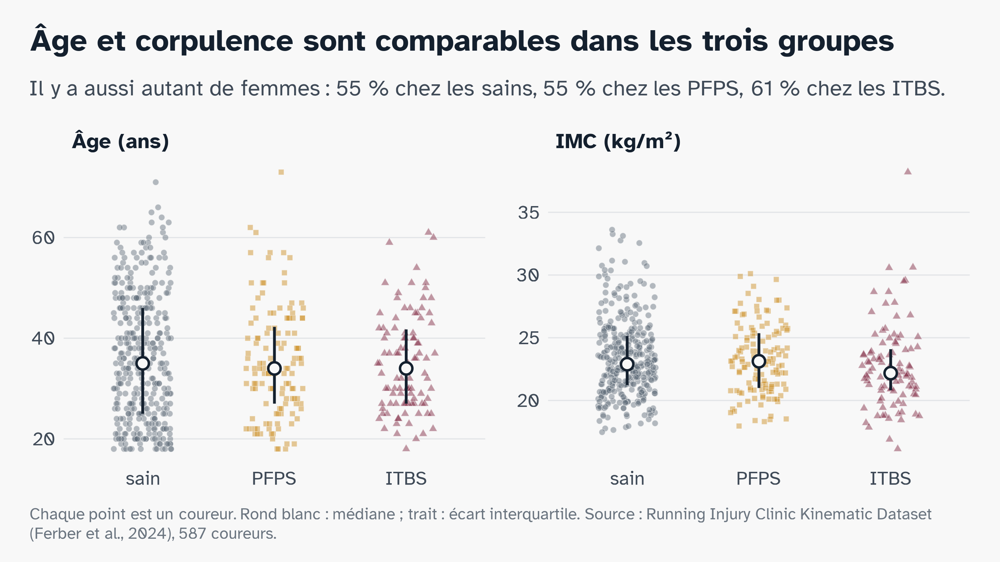
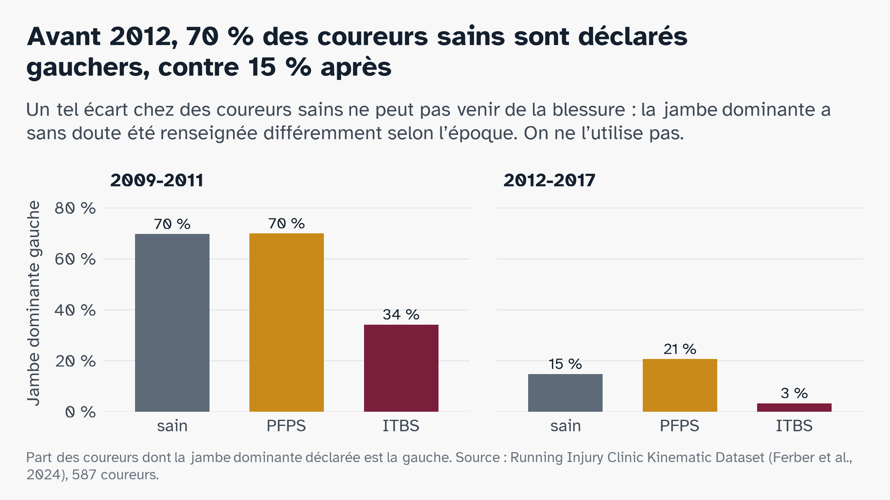
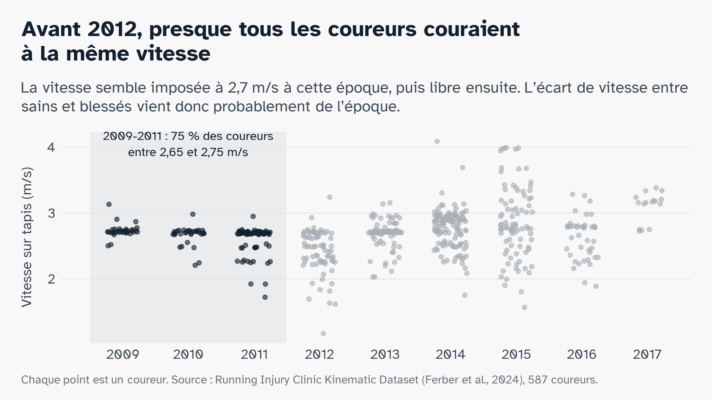

# Annexes {.partie background-color="#7A1E3A"}

Pour les questions

## Âge et corpulence sont comparables dans les trois groupes {.figure-seule}

::: {.figure-pleine}

:::

## La jambe dominante a été renseignée différemment selon l'époque {.figure-seule}

::: {.figure-pleine}

:::

## Avant 2012, la vitesse semble imposée {.figure-seule}

::: {.figure-pleine}

:::

## Description des trois groupes

::: {.petit}
| Variable | Sains | PFPS | ITBS | p (3 groupes) | p (sain / blessé) |
|---|---|---|---|---|---|
| Effectif | 361 | 128 | 98 |  |  |
| Âge (ans) | 35,0 [25,0-46,0] | 34,0 [27,0-42,2] | 34,0 [27,0-41,8] | 0,813 | 0,524 |
| Taille (cm) | 172,0 [165,0-178,6] | 173,1 [164,9-180,1] | 172,5 [165,4-177,8] | 0,886 | 0,761 |
| Poids (kg) | 68,4 [59,8-77,2] | 68,8 [59,9-79,2] | 65,2 [58,9-73,7] | 0,257 | 0,441 |
| IMC (kg/m²) | 22,9 [21,2-25,1] | 23,1 [21,0-25,4] | 22,2 [20,8-24,1] | 0,085 | 0,261 |
| Vitesse (m/s) | 2,72 [2,61-2,90] | 2,69 [2,48-2,72] | 2,70 [2,48-2,73] | < 0,001 | < 0,001 |
| Femmes, n (%) | 200 (55 %) | 71 (55 %) | 60 (61 %) | 0,572 | 0,600 |
| Jambe dominante gauche, n (%) | 77 (21 %) | 61 (48 %) | 15 (15 %) | < 0,001 | 0,001 |
| Enregistrés avant 2012, n (%) | 43 (12 %) | 70 (55 %) | 38 (39 %) | < 0,001 | < 0,001 |
:::

[Médiane [écart interquartile] ou effectif (%). Tests : Kruskal-Wallis ou χ² (3 groupes), Wilcoxon ou χ² (sain / blessé). Tableau recopié de resultats/tableau1_groupes.csv.]{.tres-petit}

## Sources

::: {.petit}
**Course et santé** : Observatoire du running, Union Sport & Cycle, 2026 · Baromètre national des pratiques sportives, INJEP, 2025 · Baromètre Odoxa, 2023 · OMS Europe, 2021 · Marathon de Paris 2026, chiffres officiels · Alter et Hershfield, PNAS, 2014

**Blessures** : van Gent et al., Br J Sports Med, 2007 · Videbæk et al., Sports Med, 2015 · Nielsen et al., Int J Sports Phys Ther, 2012 · Taunton et al., Br J Sports Med, 2002 · Francis et al., J Sports Sci Med, 2019 · premiers marathoniens de New York, Phys Sportsmed, 2021

**PFPS et ITBS** : Crossley et al., Br J Sports Med, 2016 · IASP, 2023 · revue ITBS, Curr Phys Med Rehabil Rep, 2024 · Noehren et al., Clin Biomech, 2007 · Noehren et al., Med Sci Sports Exerc, 2013

**Données et méthodes** : Ferber et al., Scientific Data, 2024 · Fuentes-Jiménez et al., arXiv, 2026 · Xiang et al., Front Neurorobot, 2022
:::

[Liens complets : bibliographie.md à la racine de la branche.]{.tres-petit}
