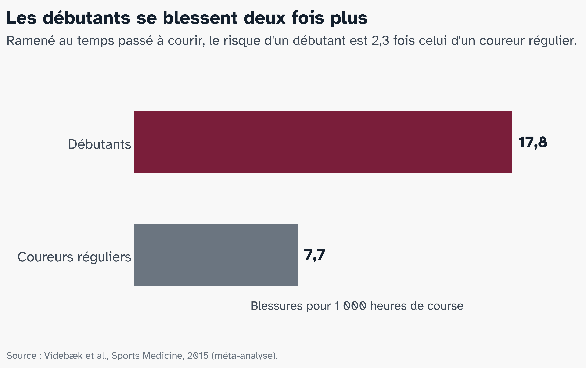
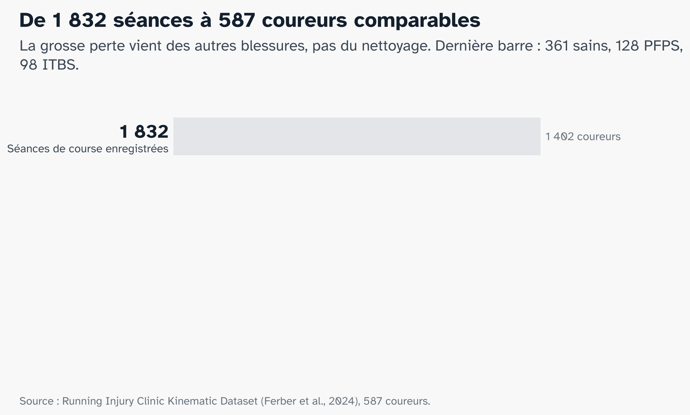
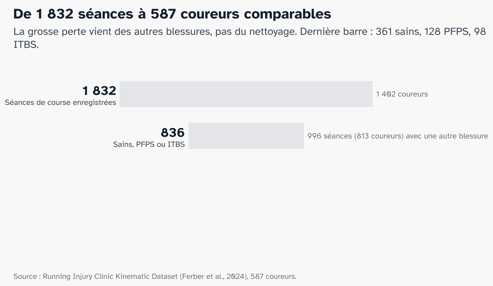
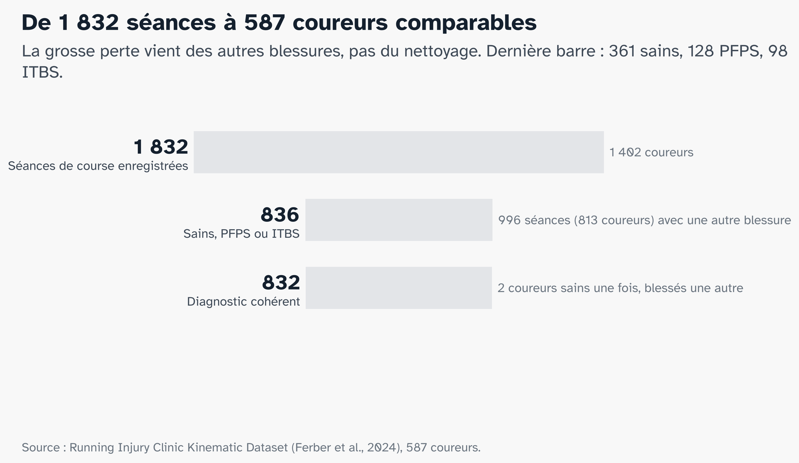
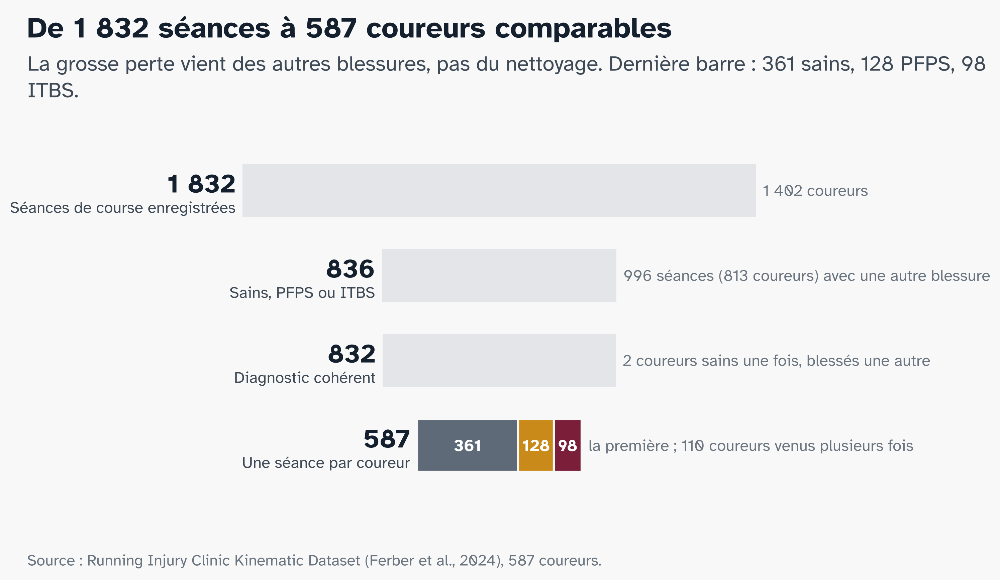
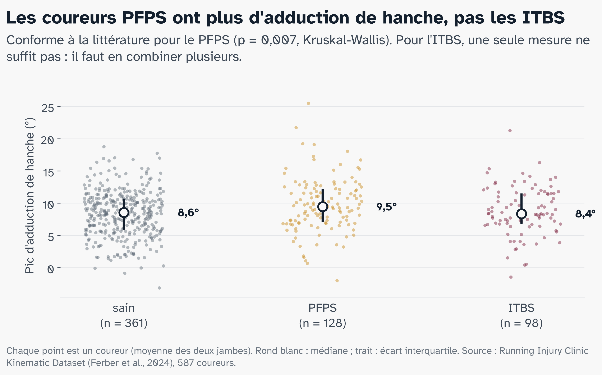
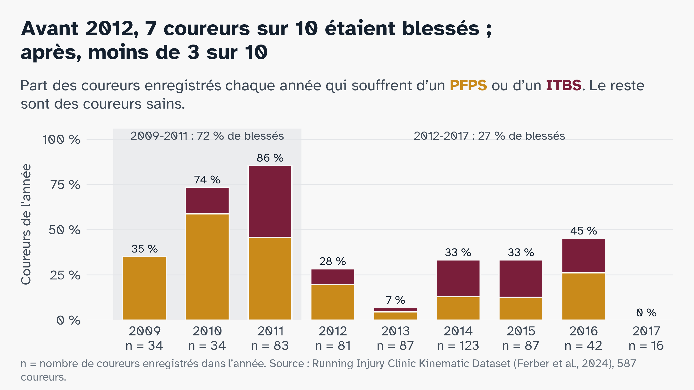
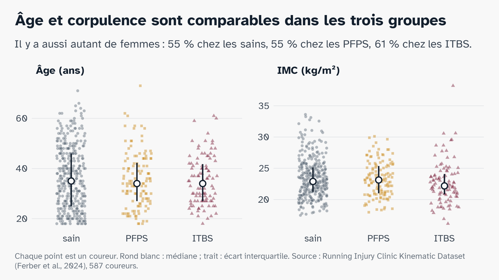
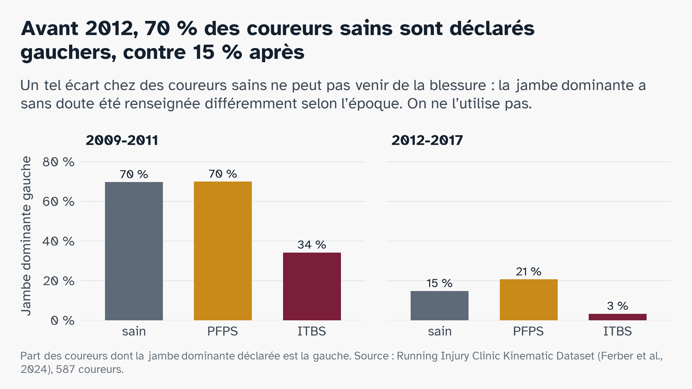
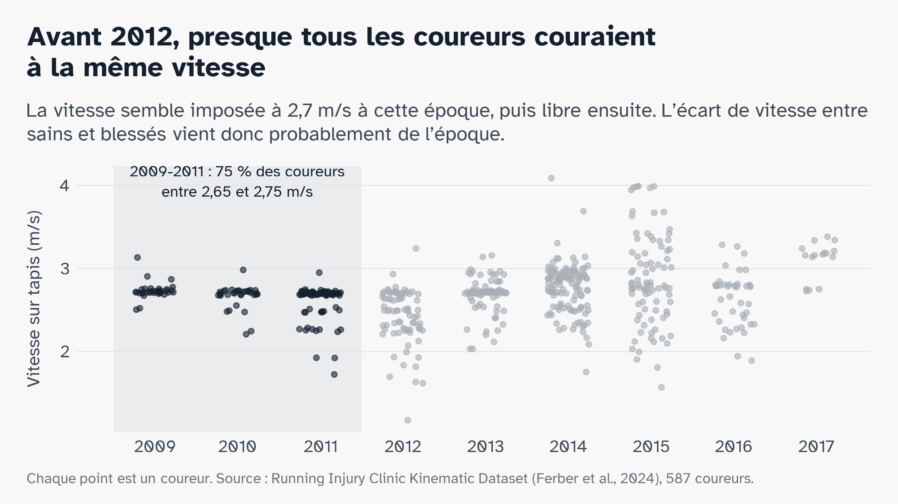

# Le problème {.partie background-color="#7A1E3A"}

## Courir : le sport santé de millions de personnes

:::: {.columns}
::: {.column width="50%"}
[13,2 M]{.chiffre}
[de Français ont couru en 2025]{.chiffre-legende}
:::
::: {.column width="50%"}
[1 sur 2]{.chiffre .jaune}
[partants du Marathon de Paris 2026 courait son premier marathon]{.chiffre-legende}
:::
::::

::: {.encadre}
On court d'abord pour sa santé : bien-être (55 %) et santé (50 %) avant la compétition.
:::

::: {.audrey}
[A]{.avatar} Audrey, 39 ans, vient de s'inscrire à son premier marathon.
:::

::: {.source}
Observatoire du running, Union Sport & Cycle, 2026 · Chiffres officiels du Marathon de Paris 2026
:::

::: notes
Audrey est un personnage fictif, construit à partir des chiffres de ces slides (âge moyen des marathoniens, débutante, crise de la décennie). Le dire si on vous le demande. Accroche : « Levez la main si vous avez couru cette année. » 40 % des Français courent au moins de temps en temps (Odoxa, 2023). Une paire de chaussures suffit : ni club, ni terrain, ni horaire, et c'est l'un des moyens les plus simples d'atteindre les 150 minutes d'activité par semaine recommandées par l'OMS.

Marathon : âge moyen 38 ans. Les gens de 29, 39 ou 49 ans sont 48 % plus nombreux que prévu parmi les premiers marathoniens : approcher une nouvelle décennie pousse à se lancer un défi, la « crise de la trentaine » mesurée dans les données (Alter et Hershfield, PNAS, 2014). Image à faire passer : un adulte qui court depuis peu et s'inscrit à un marathon.
:::

## Mais ceux qui débutent se blessent deux fois plus {.figure-seule}

::: {.figure-pleine}

:::

::: notes
Selon les études, entre 1 coureur sur 5 et 4 sur 5 se blesse à la jambe dans l'année (van Gent, 2007). Par heure de course, un débutant se blesse 2,3 fois plus qu'un coureur régulier. Hypothèse admise : le souffle progresse plus vite que les tendons, le cartilage et l'os ; on se sent capable de courir plus avant que le corps soit prêt. Pour le marathon : sur 675 premiers marathoniens à New York, 9,5 % ont eu une blessure grave qui les a empêchés de courir ou de finir.
:::

## Le genou est le premier touché

:::: {.columns}
::: {.column width="42%"}
[28 %]{.chiffre}
[des blessures du coureur, 40 % chez les coureuses]{.chiffre-legende}
:::
::: {.column width="58%"}
::: {.pastille .p}
[PFPS · syndrome fémoro-patellaire]{.nom}
[n° 1 : douleur autour de la rotule]{.detail}
:::
::: {.pastille .i}
[ITBS · syndrome de la bandelette ilio-tibiale]{.nom}
[n° 2 : douleur sur le côté externe du genou]{.detail}
:::
:::
::::

::: {.audrey}
[A]{.avatar} Trois mois plus tard, Audrey a mal au genou dès qu'elle court.
:::

::: {.source}
Francis et al., J Sports Sci Med, 2019 · Taunton et al., Br J Sports Med, 2002
:::

::: notes
Ce ne sont pas des gênes passagères : jusqu'à 57 % des adultes avec un PFPS ont encore une évolution défavorable 5 à 8 ans après (IASP, 2023). Vérifié dans nos données : le genou est l'articulation la plus souvent blessée, et PFPS et ITBS sont les deux diagnostics précis les plus fréquents de la clinique.
:::

## Deux douleurs au genou, une origine à la hanche

:::: {.columns}
::: {.column width="46%"}
```{=html}
<svg viewBox="0 0 640 620" width="100%" role="img" aria-label="Jambe droite vue de face : quand la cuisse rentre, le genou part vers l'intérieur">
  <defs>
    <marker id="fl" viewBox="0 0 10 10" refX="8" refY="5" markerWidth="7" markerHeight="7" orient="auto-start-reverse">
      <path d="M0 0L10 5L0 10z" fill="#14202E"/>
    </marker>
  </defs>
  <line x1="470" y1="40" x2="470" y2="580" stroke="#B9BEC5" stroke-width="2" stroke-dasharray="8 8"/>
  <text x="478" y="60" font-size="20" fill="#6B7580">axe du corps</text>
  <path d="M150 120 Q300 70 470 105 L470 160 Q300 135 180 175 Z" fill="#E3E5E8" stroke="#5E6A77" stroke-width="3"/>
  <text x="300" y="100" font-size="22" fill="#3F4A57" text-anchor="middle">bassin</text>
  <line x1="250" y1="175" x2="250" y2="360" stroke="#B9BEC5" stroke-width="22" stroke-linecap="round" opacity="0.6"/>
  <line x1="250" y1="360" x2="250" y2="560" stroke="#B9BEC5" stroke-width="18" stroke-linecap="round" opacity="0.6"/>
  <g class="fragment" data-fragment-index="1">
    <line x1="250" y1="175" x2="320" y2="360" stroke="#5E6A77" stroke-width="26" stroke-linecap="round"/>
    <line x1="320" y1="360" x2="275" y2="560" stroke="#5E6A77" stroke-width="20" stroke-linecap="round"/>
    <path d="M262 300 Q300 290 330 300" fill="none" stroke="#14202E" stroke-width="3.5" marker-end="url(#fl)"/>
    <text x="300" y="260" font-size="20" fill="#14202E" font-weight="700">la cuisse rentre</text>
  </g>
  <circle cx="250" cy="175" r="22" fill="#5E6A77"/>
  <g class="fragment" data-fragment-index="2">
    <path d="M175 165 C205 260 260 330 292 378" fill="none" stroke="#7A1E3A" stroke-width="7" stroke-linecap="round"/>
    <circle cx="292" cy="372" r="20" fill="#7A1E3A" fill-opacity="0.25" stroke="#7A1E3A" stroke-width="3"/>
    <ellipse cx="326" cy="352" rx="17" ry="22" fill="#fff" stroke="#C98A1A" stroke-width="4"/>
    <circle cx="326" cy="352" r="36" fill="#C98A1A" fill-opacity="0.18"/>
    <text x="372" y="330" font-size="24" font-weight="700" fill="#C98A1A">PFPS</text>
    <text x="372" y="356" font-size="20" fill="#3F4A57">autour de la rotule</text>
    <text x="60" y="440" font-size="24" font-weight="700" fill="#7A1E3A">ITBS</text>
    <text x="60" y="466" font-size="20" fill="#3F4A57">côté externe</text>
    <line x1="150" y1="430" x2="272" y2="385" stroke="#7A1E3A" stroke-width="2"/>
  </g>
  <text x="300" y="605" font-size="18" fill="#6B7580" text-anchor="middle">Jambe droite vue de face. Gris clair : alignement neutre.</text>
</svg>
```
:::
::: {.column width="54%"}
Filmées **avant** de se blesser, les coureuses qui ont eu ensuite un [PFPS]{.pfps} ou un [ITBS]{.itbs} avaient plus d'**adduction de hanche** : la cuisse rentre vers l'intérieur.

::: {.encadre .fragment fragment-index=3}
Pour comprendre la blessure, il faut regarder la foulée.
:::
:::
::::

::: {.source}
Noehren et al., Clin Biomech, 2007 · Noehren et al., Med Sci Sports Exerc, 2013
:::

::: notes
Trois clics : la jambe neutre ; la cuisse rentre (adduction de hanche) ; les deux douleurs apparaissent ; la phrase à retenir. PFPS : 400 coureuses suivies, 15 cas, plus d'adduction de hanche avant la blessure. ITBS : 18 cas, plus d'adduction de hanche et de rotation interne du genou. Les deux partagent un signe, l'ITBS y ajoute une rotation : elles se ressemblent dans la foulée sans être identiques. Mécanisme ITBS actuel : compression d'un coussinet graisseux très innervé quand le genou dépasse environ 30° de flexion, juste après l'impact.
:::

## Aucun examen ne tranche : la foulée peut-elle aider ?

```{=html}
<svg viewBox="0 0 1400 230" width="100%" role="img" aria-label="Parcours diagnostique : douleur au genou, examen à l'arrêt, on écarte les autres causes, diagnostic incertain">
  <defs>
    <marker id="fd" viewBox="0 0 10 10" refX="8" refY="5" markerWidth="8" markerHeight="8" orient="auto">
      <path d="M0 0L10 5L0 10z" fill="#6B7580"/>
    </marker>
  </defs>
  <g font-size="26" text-anchor="middle">
    <rect x="10" y="40" width="290" height="120" rx="16" fill="#fff" stroke="#E3E5E8" stroke-width="3"/>
    <text x="155" y="92" font-weight="700" fill="#14202E">Douleur</text>
    <text x="155" y="126" fill="#3F4A57">au genou</text>
    <rect x="370" y="40" width="290" height="120" rx="16" fill="#fff" stroke="#E3E5E8" stroke-width="3"/>
    <text x="515" y="92" font-weight="700" fill="#14202E">Examen</text>
    <text x="515" y="126" fill="#3F4A57">à l'arrêt</text>
    <rect x="730" y="40" width="290" height="120" rx="16" fill="#fff" stroke="#E3E5E8" stroke-width="3"/>
    <text x="875" y="92" font-weight="700" fill="#14202E">On écarte</text>
    <text x="875" y="126" fill="#3F4A57">les autres causes</text>
    <rect x="1090" y="40" width="300" height="120" rx="16" fill="#F6E7C8" stroke="#C98A1A" stroke-width="4"/>
    <text x="1240" y="94" font-weight="700" fill="#14202E"><tspan fill="#C98A1A">PFPS</tspan> ? <tspan fill="#7A1E3A">ITBS</tspan> ?</text>
    <text x="1240" y="128" fill="#3F4A57">sans test de référence</text>
  </g>
  <g stroke="#6B7580" stroke-width="3">
    <line x1="305" y1="100" x2="362" y2="100" marker-end="url(#fd)"/>
    <line x1="665" y1="100" x2="722" y2="100" marker-end="url(#fd)"/>
    <line x1="1025" y1="100" x2="1082" y2="100" marker-end="url(#fd)"/>
  </g>
  <text x="515" y="205" font-size="22" fill="#7A1E3A" text-anchor="middle" font-weight="700">or la blessure se joue en courant</text>
</svg>
```

::: {.audrey}
[A]{.avatar} Son kiné hésite : PFPS ? ITBS ? Rien ne permet de trancher.
:::

::: {.question .fragment}
La foulée suffit-elle à reconnaître un coureur atteint d'un PFPS ou d'un ITBS ?
:::

::: {.question .fragment}
Ce que regardent les modèles a-t-il un sens biologique ?
:::

::: {.source}
Crossley et al., consensus PFPS, Br J Sports Med, 2016 · revue ITBS, Curr Phys Med Rehabil Rep, 2024
:::

::: notes
PFPS : pas de test clinique définitif, pas besoin d'imagerie ; on le retient quand on n'a rien trouvé d'autre. ITBS : sensibilité et spécificité des tests jugées « pas satisfaisantes ». Dans notre clinique, le diagnostic le plus fréquent n'est ni l'un ni l'autre mais « douleur » (232 séances sur 1 832). D'où l'idée : lire la foulée elle-même. Deux outils : le machine learning compare des mesures résumées, le deep learning lit la courbe entière.
:::

# Les données {.partie background-color="#7A1E3A"}

## Une clinique a filmé près de 1 800 coureurs

:::: {.columns}
::: {.column width="58%"}
```{=html}
<svg viewBox="0 0 760 560" width="100%" role="img" aria-label="Coureur sur tapis filmé par des caméras infrarouges, marqueurs sur sept segments">
  <g fill="#14202E">
    <rect x="40" y="40" width="64" height="40" rx="6"/><circle cx="110" cy="60" r="12"/>
    <rect x="640" y="40" width="64" height="40" rx="6"/><circle cx="634" cy="60" r="12"/>
  </g>
  <g stroke="#B9BEC5" stroke-width="2" stroke-dasharray="6 8">
    <line x1="120" y1="68" x2="330" y2="300"/><line x1="624" y1="68" x2="420" y2="300"/>
  </g>
  <text x="40" y="112" font-size="20" fill="#3F4A57">caméras infrarouges</text>
  <rect x="150" y="470" width="470" height="26" rx="13" fill="#5E6A77"/>
  <circle cx="170" cy="483" r="9" fill="#E3E5E8"/><circle cx="600" cy="483" r="9" fill="#E3E5E8"/>
  <text x="385" y="530" font-size="20" fill="#3F4A57" text-anchor="middle">tapis de course, vitesse choisie par le coureur</text>
  <line x1="385" y1="250" x2="400" y2="140" stroke="#B9BEC5" stroke-width="22" stroke-linecap="round"/>
  <circle cx="405" cy="105" r="26" fill="#B9BEC5"/>
  <line x1="398" y1="160" x2="440" y2="215" stroke="#B9BEC5" stroke-width="12" stroke-linecap="round"/>
  <line x1="440" y1="215" x2="470" y2="180" stroke="#B9BEC5" stroke-width="12" stroke-linecap="round"/>
  <line x1="395" y1="165" x2="360" y2="220" stroke="#B9BEC5" stroke-width="12" stroke-linecap="round"/>
  <line x1="385" y1="255" x2="330" y2="345" stroke="#9AA3AD" stroke-width="20" stroke-linecap="round"/>
  <line x1="330" y1="345" x2="262" y2="385" stroke="#9AA3AD" stroke-width="16" stroke-linecap="round"/>
  <line x1="262" y1="385" x2="280" y2="412" stroke="#9AA3AD" stroke-width="12" stroke-linecap="round"/>
  <line x1="385" y1="255" x2="420" y2="360" stroke="#5E6A77" stroke-width="22" stroke-linecap="round"/>
  <line x1="420" y1="360" x2="398" y2="455" stroke="#5E6A77" stroke-width="18" stroke-linecap="round"/>
  <line x1="390" y1="458" x2="448" y2="466" stroke="#5E6A77" stroke-width="13" stroke-linecap="round"/>
  <rect x="362" y="238" width="46" height="30" rx="12" fill="#14202E"/>
  <g stroke="#14202E" stroke-width="2.5" fill="#fff">
    <rect x="392" y="292" width="26" height="26" rx="5"/>
    <rect x="398" y="397" width="24" height="24" rx="5"/>
    <rect x="376" y="447" width="18" height="18" rx="4"/>
    <rect x="344" y="290" width="22" height="22" rx="5"/>
    <rect x="285" y="355" width="20" height="20" rx="4"/>
  </g>
  <g fill="#7A1E3A">
    <circle cx="398" cy="298" r="3.5"/><circle cx="412" cy="298" r="3.5"/><circle cx="405" cy="311" r="3.5"/>
    <circle cx="404" cy="403" r="3.5"/><circle cx="416" cy="403" r="3.5"/><circle cx="410" cy="415" r="3.5"/>
    <circle cx="381" cy="452" r="3"/><circle cx="389" cy="452" r="3"/><circle cx="385" cy="460" r="3"/>
    <circle cx="350" cy="296" r="3"/><circle cx="360" cy="296" r="3"/><circle cx="355" cy="306" r="3"/>
    <circle cx="290" cy="360" r="3"/><circle cx="300" cy="360" r="3"/><circle cx="295" cy="370" r="3"/>
    <circle cx="372" cy="246" r="3.5"/><circle cx="385" cy="246" r="3.5"/><circle cx="398" cy="246" r="3.5"/>
  </g>
  <g font-size="20" fill="#3F4A57">
    <text x="470" y="250">bassin</text><line x1="412" y1="252" x2="465" y2="245" stroke="#3F4A57" stroke-width="1.5"/>
    <text x="470" y="312">cuisse</text><line x1="421" y1="306" x2="465" y2="306" stroke="#3F4A57" stroke-width="1.5"/>
    <text x="470" y="412">jambe</text><line x1="424" y1="409" x2="465" y2="406" stroke="#3F4A57" stroke-width="1.5"/>
    <text x="470" y="462">pied</text><line x1="452" y1="463" x2="465" y2="457" stroke="#3F4A57" stroke-width="1.5"/>
  </g>
  <text x="40" y="300" font-size="20" fill="#7A1E3A" font-weight="700">marqueurs</text>
  <text x="40" y="324" font-size="18" fill="#3F4A57">3-4 par plaque</text>
  <line x1="150" y1="310" x2="280" y2="362" stroke="#7A1E3A" stroke-width="1.5"/>
</svg>
```
:::
::: {.column width="42%"}
- Calgary, **2009 à 2017**
- **1 798** personnes
- **7 segments** suivis, du bassin aux pieds

::: {.encadre}
L'angle de chaque articulation, à chaque instant de la course.
:::

::: {.audrey}
[A]{.avatar} Audrey aurait couru une minute sur ce tapis.
:::
:::
::::

::: {.source}
Ferber et al., Scientific Data, 2024 · Running Injury Clinic Kinematic Dataset, Figshare (CC BY 4.0)
:::

::: notes
Running Injury Clinic, Université de Calgary. Environ 60 secondes de course sur tapis à vitesse libre ; caméras infrarouges Vicon, environ 200 images par seconde ; marqueurs sur le bassin, les deux cuisses, les deux jambes et les deux pieds. Le diagnostic de chaque blessé a été posé par la clinique. Données ouvertes publiées en 2024. Détail pour les questions : le fichier complet fait 22,7 Go ; on n'a lu que les morceaux utiles (environ 6 Go), directement sur le serveur.
:::

## De 1 832 séances à 587 coureurs {.figure-seule}

::: {.r-stack .figure-pleine}
{.fragment .fade-out fragment-index=1}

{.fragment .fade-in-then-out fragment-index=1}

{.fragment .fade-in-then-out fragment-index=2}

{.fragment fragment-index=3}
:::

::: notes
Une étape par clic. Insister : la grosse perte vient des coureurs qui ont une autre blessure (environ 813), pas du nettoyage, qui ne retire que 2 coureurs. 1) On garde les sains, les PFPS et les ITBS. 2) On retire 2 coureurs déclarés sains une fois et blessés une autre. 3) Une seule séance par coureur : sinon le même coureur pourrait se retrouver à la fois dans les données d'entraînement et de test, et le modèle le reconnaîtrait au lieu de reconnaître la blessure. À retenir : 361 sains, 128 PFPS, 98 ITBS.
:::

## 40 mesures par jambe, du bassin au pied

::: {.cartes}
::: {.carte .cle}
[Bassin]{.fam}[3]{.nb}chute du bassin
:::
::: {.carte .cle}
[Hanche]{.fam}[8]{.nb}extension, **adduction**, rotation
:::
::: {.carte .cle}
[Genou]{.fam}[10]{.nb}flexion, varus, valgus, **rotation**
:::
::: {.carte}
[Cheville]{.fam}[10]{.nb}flexion, pronation, rotation
:::
::: {.carte}
[Pied]{.fam}[3]{.nb}attaque au sol, ouverture
:::
::: {.carte}
[Foulée]{.fam}[6]{.nb}cadence, longueur, temps d'appui
:::
:::

::: {.encadre}
En rouge : là où la littérature attend les différences. 79 variables par coureur.
:::

::: notes
Pour chaque articulation : pics, amplitudes et vitesses des angles. Chaque mesure est la médiane sur toutes les foulées enregistrées, calculée par la clinique. Gauche + droite, avec la largeur de pas commune aux deux jambes : 79 variables par coureur. Ce sont les entrées du modèle classique ; le deep learning, lui, lira les courbes complètes des angles pendant l'appui.
:::

## Dans nos données, la hanche se comporte-t-elle comme prévu ? {.figure-seule}

::: {.figure-pleine}

:::

::: notes
Notre propre vérification de l'hypothèse H1, avant tout modèle. Résultat : les PFPS ont plus d'adduction de hanche (médiane 9,5° contre 8,6° chez les sains, p = 0,007), comme chez Noehren ; les ITBS non (8,4°). L'écart des PFPS tient sur 2012-2017 seulement (9,7° contre 8,5°), donc ce n'est pas un effet de l'époque. Message : pour le PFPS, une mesure suffit à voir une tendance ; pour l'ITBS, il faut combiner plusieurs mesures, c'est le rôle des modèles. Attention : la différence de groupe ne permet pas de classer un coureur seul, les nuages de points se chevauchent largement.
:::

## Attention : l'époque se confond avec la blessure {.figure-seule}

::: {.figure-pleine}

:::

::: notes
Avant 2012, 7 coureurs sur 10 sont blessés ; après, moins de 3 sur 10. Or le protocole et la façon de remplir les fiches ont changé entre les deux périodes (vitesse imposée avant 2012, jambe dominante renseignée différemment : voir annexes). Un modèle pourrait donc apprendre l'époque au lieu de la blessure. Ce qu'on fait : l'année n'entre jamais dans les modèles, et on vérifie les résultats sur 2012-2017 seulement. L'article de référence ne fait pas cette vérification. Transition vers Lilou : « À l'œil, ces différences sont trop fines. Un modèle peut-il les voir ? »
:::

# Méthodologie {.partie background-color="#7A1E3A"}

## Peut-on reconnaître un coureur blessé à ses mesures ?

::: {.a-completer}
**À compléter par Lilou.** Un schéma simple : 587 coureurs → 79 mesures → modèle → « sain » ou « blessé ». Les modèles testés (régression logistique, forêt aléatoire, SVM) et la validation croisée **par coureur**, 5 plis répétés 5 fois, les mêmes que pour le deep learning.
:::

::: {.audrey}
[A]{.avatar} Le modèle aurait-il reconnu Audrey parmi les coureurs sains ?
:::

::: notes
Introduire chaque méthode par la question qu'elle sert : « on veut savoir si les mesures suffisent, donc on commence par le modèle le plus simple qui puisse répondre ».
:::

## Le piège : répondre toujours « sain » donne 61 % de bonnes réponses

:::: {.columns}
::: {.column width="45%"}
[61,5 %]{.chiffre}
[de bonnes réponses sans rien regarder : 361 sains sur 587]{.chiffre-legende}
:::
::: {.column width="55%"}
On juge donc chaque modèle sur :

- les **blessés** reconnus (sensibilité)
- les **sains** reconnus (spécificité)
- leur moyenne : 50 % = le hasard
:::
::::

::: notes
La moyenne de la sensibilité et de la spécificité s'appelle l'exactitude équilibrée. C'est le chiffre de référence pour tout le reste de la présentation.
:::

## [Message de Lilou : un seul chiffre clé]

::: {.a-completer}
**À compléter par Lilou.** Un titre sous forme de phrase, par exemple « Le modèle reconnaît X blessés sur 10 ». Un seul chiffre sur la slide ; le tableau complet des scores, des modèles et des hyperparamètres va en annexe.
:::

## [Quelles mesures pèsent dans la décision ?]

::: {.a-completer}
**À compléter par Lilou.** SHAP ou LIME sur la forêt aléatoire : les 5 à 8 variables qui comptent le plus. Les colorer par famille (bassin, hanche, genou…) comme sur la slide « 40 mesures par jambe », pour que le lien avec la biologie se voie.
:::

::: notes
Transition vers Charles : « Ces mesures résumées suffisent-elles, ou faut-il lire la courbe entière ? »
:::

# Illustration {.partie background-color="#7A1E3A"}

## [Le réseau lit la courbe entière, pas seulement ses pics]

::: {.a-completer}
**À compléter par Charles.** Une courbe d'angle du genou pendant l'appui (0 à 100 %), avec ce que garde le modèle classique (le pic) et ce que lit le réseau (toute la courbe). Puis le principe d'un réseau convolutif 1D en une image.
:::

## [Le détail du mouvement aide-t-il ?]

::: {.a-completer}
**À compléter par Charles.** Comparaison avec les modèles de Lilou, sur les mêmes plis : un seul chiffre ou un graphe simple. Si le deep learning ne fait pas mieux, c'est un résultat : sur 587 coureurs, les mesures résumées suffisent.
:::

## [Où regarde le réseau dans la foulée ?]

::: {.a-completer}
**À compléter par Charles.** Carte de saillance sur la courbe : quelle articulation, à quel moment de l'appui. Titre-message du type « Le réseau se concentre sur la hanche en milieu d'appui ».
:::

## [Les modèles regardent-ils là où la biologie l'attend ?] {.etape-bio}

| Ce qu'attend la littérature | Ce que regardent nos modèles |
|---|---|
| [PFPS]{.pfps} : adduction de hanche | *à remplir avec Lilou et Charles* |
| [ITBS]{.itbs} : adduction de hanche + rotation du genou | *à remplir* |
| les deux : chute du bassin | *à remplir* |

::: notes
La slide qui ferme la boucle avec le début. Si les variables et les moments mis en avant par les modèles rejoignent la littérature, les modèles ont appris quelque chose de biologiquement cohérent ; sinon, il faut se demander s'ils ont appris l'époque ou un autre biais.
:::

## Limites et suite {.etape-bio}

:::: {.columns}
::: {.column width="50%"}
**Limites**

- coureurs **déjà blessés** : cause ou effet ?
- **époque** confondue avec le diagnostic
- **une clinique**, sur tapis
:::
::: {.column width="50%"}
**Demain**

- des **capteurs portables** dans la chaussure
- repérer une foulée à risque **chez un débutant**, avant la douleur
:::
::::

::: {.audrey}
[A]{.avatar} Demain, un capteur dans la chaussure d'Audrey l'aurait prévenue avant la douleur.
:::

::: {.encadre}
Garder les gens en train de courir, c'est garder le bénéfice santé qui les a fait commencer.
:::

::: notes
Dire les limites avant que le jury ne les pose. La première est la plus importante : c'est la différence entre détecter et prédire. Pour prédire, il faudrait une étude prospective : mesurer la foulée, puis suivre les coureurs. Les capteurs portables mesurent déjà la foulée hors du laboratoire (Xiang et al., Frontiers in Neurorobotics, 2022).
:::

## Trois messages à retenir {.etape-bio}

::: {.retenir}
[1]{.num} La foulée des coureurs blessés [porte / ne porte pas]{.a-trancher} la trace du PFPS et de l'ITBS.
:::
::: {.retenir .fragment}
[2]{.num} Les modèles regardent [la hanche et le bassin / autre chose]{.a-trancher}, comme l'annonçait la biologie.
:::
::: {.retenir .fragment}
[3]{.num} Avant de croire un score, vérifier ce que le modèle a appris : ici, l'époque.
:::

::: notes
Une phrase par message, lentement. Les parties entre crochets sont à trancher avec les résultats de Lilou et Charles. Finir en regardant le public, puis passer aux questions.
:::

## Merci {.merci background-color="#7A1E3A"}

Questions ?

[Code et données : branche du groupe sur le dépôt GitHub de l'école d'automne]{.tres-petit}

# Annexes {.partie background-color="#7A1E3A"}

Pour les questions

## Âge et corpulence sont comparables dans les trois groupes {.figure-seule}

::: {.figure-pleine}

:::

## La jambe dominante a été renseignée différemment selon l'époque {.figure-seule}

::: {.figure-pleine}

:::

## Avant 2012, la vitesse semble imposée {.figure-seule}

::: {.figure-pleine}

:::

## Description des trois groupes

::: {.petit}
| Variable | Sains | PFPS | ITBS | p (3 groupes) | p (sain / blessé) |
|---|---|---|---|---|---|
| Effectif | 361 | 128 | 98 |  |  |
| Âge (ans) | 35,0 [25,0-46,0] | 34,0 [27,0-42,2] | 34,0 [27,0-41,8] | 0,813 | 0,524 |
| Taille (cm) | 172,0 [165,0-178,6] | 173,1 [164,9-180,1] | 172,5 [165,4-177,8] | 0,886 | 0,761 |
| Poids (kg) | 68,4 [59,8-77,2] | 68,8 [59,9-79,2] | 65,2 [58,9-73,7] | 0,257 | 0,441 |
| IMC (kg/m²) | 22,9 [21,2-25,1] | 23,1 [21,0-25,4] | 22,2 [20,8-24,1] | 0,085 | 0,261 |
| Vitesse (m/s) | 2,72 [2,61-2,90] | 2,69 [2,48-2,72] | 2,70 [2,48-2,73] | < 0,001 | < 0,001 |
| Femmes, n (%) | 200 (55 %) | 71 (55 %) | 60 (61 %) | 0,572 | 0,600 |
| Jambe dominante gauche, n (%) | 77 (21 %) | 61 (48 %) | 15 (15 %) | < 0,001 | 0,001 |
| Enregistrés avant 2012, n (%) | 43 (12 %) | 70 (55 %) | 38 (39 %) | < 0,001 | < 0,001 |
:::

[Médiane [écart interquartile] ou effectif (%). Tests : Kruskal-Wallis ou χ² (3 groupes), Wilcoxon ou χ² (sain / blessé). Tableau recopié de resultats/tableau1_groupes.csv.]{.tres-petit}

## Sources

::: {.petit}
**Course et santé** : Observatoire du running, Union Sport & Cycle, 2026 · Baromètre national des pratiques sportives, INJEP, 2025 · Baromètre Odoxa, 2023 · OMS Europe, 2021 · Marathon de Paris 2026, chiffres officiels · Alter et Hershfield, PNAS, 2014

**Blessures** : van Gent et al., Br J Sports Med, 2007 · Videbæk et al., Sports Med, 2015 · Nielsen et al., Int J Sports Phys Ther, 2012 · Taunton et al., Br J Sports Med, 2002 · Francis et al., J Sports Sci Med, 2019 · premiers marathoniens de New York, Phys Sportsmed, 2021

**PFPS et ITBS** : Crossley et al., Br J Sports Med, 2016 · IASP, 2023 · revue ITBS, Curr Phys Med Rehabil Rep, 2024 · Noehren et al., Clin Biomech, 2007 · Noehren et al., Med Sci Sports Exerc, 2013

**Données et méthodes** : Ferber et al., Scientific Data, 2024 · Fuentes-Jiménez et al., arXiv, 2026 · Xiang et al., Front Neurorobot, 2022
:::

[Liens complets : bibliographie.md à la racine de la branche.]{.tres-petit}
